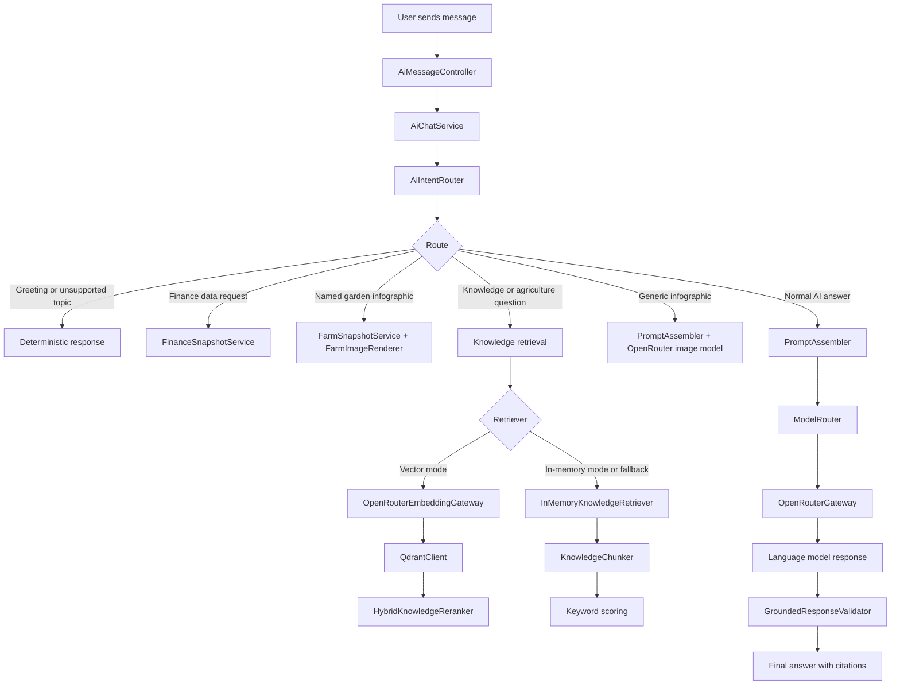

# Farmer IC AI Architecture: `app/AI/Services`

This folder contains the application’s AI orchestration layer. It connects:

- the user’s chat message;
- intent detection;
- farm and finance data;
- knowledge retrieval;
- embeddings and vector search;
- an external language model through OpenRouter;
- image generation or deterministic SVG rendering;
- validation, citations, fallback handling, and observability.

The central class is [AiChatService.php](app/AI/Services/AiChatService.php). Most other services support one specific stage of its pipeline.

---

## 1. The architecture at a glance

The system is a combination of:

1. **Traditional application logic**
   - routing;
   - database queries;
   - finance calculations;
   - validation;
   - fallback messages.

2. **Retrieval-Augmented Generation, or RAG**
   - find relevant farm knowledge;
   - give that knowledge to the language model;
   - ask the model to answer using the supplied evidence.

3. **Generative AI**
   - text generation;
   - streaming responses;
   - image generation;
   - embeddings.

A simplified request flow looks like this:



The application does not send every message directly to an AI model. It first decides what kind of request it is and whether the answer can be produced deterministically.

---

# 2. How a chat request enters the system

The controller is outside `app/AI/Services`, but it explains how the services are used.

[ AiMessageController.php](C:/Users/iryad/Downloads/farmer-ic/app/Http/Controllers/AI/AiMessageController.php) does the following:

1. Finds or creates an AI conversation.
2. Stores the user’s uploaded attachments.
3. Creates the user message.
4. Calls:

```php
$this->chat->streamReply(...)
```

5. Sends the generated events to the browser using Server-Sent Events.

The important point is that `AiChatService` does not directly receive an HTTP request. The controller prepares the conversation and delegates the AI work to it.

---

# 3. `AiChatService`: the main orchestrator

File: [AiChatService.php](C:/Users/iryad/Downloads/farmer-ic/app/AI/Services/AiChatService.php)

This is the application’s AI coordinator. It injects almost every important service:

```php
private readonly LlmGateway $gateway,
private readonly ModelRouter $models,
private readonly KnowledgeService $knowledge,
private readonly PromptAssembler $prompts,
private readonly AttachmentService $attachments,
private readonly AiIntentRouter $router,
private readonly KnowledgeRetriever $retriever,
private readonly InMemoryKnowledgeRetriever $fallbackRetriever,
private readonly GroundedResponseValidator $groundedValidator,
private readonly FinanceSnapshotService $financeSnapshot,
private readonly FinanceImageRenderer $financeImageRenderer,
private readonly FarmSnapshotService $farmSnapshot,
private readonly FarmImageRenderer $farmImageRenderer,
```

## Main responsibilities

### Conversation creation

`createConversation()` creates an `AiConversation` and stores a snapshot of the current knowledge context.

That snapshot includes:

- application facts;
- assistant policy;
- published team knowledge;
- hashes identifying the version of the knowledge.

The snapshot makes the conversation’s context more stable. If the knowledge base changes later, an existing conversation still knows which knowledge snapshot it started with.

### User message creation

`createUserMessage()`:

- stores uploaded files through `AttachmentService`;
- creates a database message with role `user`;
- associates attachments with that message;
- updates the conversation timestamp;
- automatically creates a title from the first message.

### Response streaming

`streamReply()` is the main pipeline.

It:

1. Finds the active user message.
2. Checks that the message belongs to the current conversation.
3. Detects whether an image attachment exists.
4. Looks at the previous assistant message to preserve domain context.
5. Routes the prompt using `AiIntentRouter`.
6. Checks whether the user wants an infographic.
7. Handles finance and named-garden requests deterministically.
8. Retrieves relevant knowledge.
9. Builds a prompt.
10. Chooses one or more models.
11. Streams model output.
12. Validates citations and finance numbers.
13. Saves usage and latency metadata.
14. Emits progress, delta, done, or error events.

The service can produce events such as:

```text
message.progress
message.start
message.delta
message.done
message.error
```

The browser receives these events while the model is still generating the answer.

---

# 4. Intent routing

## `AiIntentRouter`

File: [AiIntentRouter.php](C:/Users/iryad/Downloads/farmer-ic/app/AI/Services/AiIntentRouter.php)

This service classifies a user message before any expensive AI call.

It detects:

- domain;
- intent;
- period;
- topic;
- confidence;
- ambiguity;
- whether clarification is needed.

## Domains

The router recognizes domains such as:

- `finance`;
- `agronomy`;
- `garden`;
- `activity`;
- `general`.

It uses word lists such as:

```php
private const FINANCE_TERMS = [
    'keuangan',
    'pendapatan',
    'pengeluaran',
    'laba',
    'saldo',
];
```

This is a deterministic rule-based classifier. It is not itself a machine-learning model.

## Intents

Examples include:

| Intent | Meaning |
|---|---|
| `llm` | Ask a language model to formulate an answer |
| `data` | Look up application data |
| `knowledge` | Retrieve knowledge-base content |
| `infographic` | Generate or render a visual |
| `out_of_scope` | Reject unsupported topics |

For example:

```text
"Berapa pengeluaran bulan ini?"
```

may become:

```text
intent: llm
domain: finance
period: current
```

While:

```text
"Buatkan infografis kondisi Kebun Utama"
```

may become:

```text
intent: infographic
domain: garden
```

## Why routing is useful

Routing allows the application to avoid unnecessary model calls.

For example:

- a greeting can receive a fixed response;
- a finance total can be calculated from records;
- a named garden infographic can be rendered locally;
- only open-ended explanations need the language model.

The result is represented by [AiRouteDecision.php](C:/Users/iryad/Downloads/farmer-ic/app/AI/Data/AiRouteDecision.php).

---

# 5. Model selection

## `ModelRouter`

File: [ModelRouter.php](C:/Users/iryad/Downloads/farmer-ic/app/AI/Services/ModelRouter.php)

This service selects the provider model candidates.

For text requests it combines:

1. an optional fast model;
2. the configured primary model;
3. configured text fallback models.

For image requests it uses a separate infographic model list.

Example configuration comes from [config/ai.php](C:/Users/iryad/Downloads/farmer-ic/config/ai.php):

```php
'primary' => ...,
'text_fallbacks' => [...],
'vision_fallbacks' => [...],
'infographic_model' => ...,
```

The first model is attempted first. If the provider returns a retryable error, `AiChatService` tries the next model.

This is similar to a backup chain:

```text
Primary model
   ↓ fails
Text fallback 1
   ↓ fails
Text fallback 2
```

---

# 6. Prompt construction

## `PromptAssembler`

File: [PromptAssembler.php](C:/Users/iryad/Downloads/farmer-ic/app/AI/Services/PromptAssembler.php)

The language model does not receive only the latest user message. This service builds the complete prompt.

It includes:

- a system instruction;
- application facts;
- assistant policy;
- retrieved evidence;
- recent conversation history;
- selected image attachments.

The prompt has two main variants:

```php
systemPrompt(...)
infographicSystemPrompt(...)
```

## System prompt

The normal system prompt tells the model:

- answer in Indonesian;
- behave like a farm advisor;
- use only supplied application facts and evidence;
- cite evidence as `[S1]`, `[S2]`, etc.;
- avoid revealing system instructions;
- avoid inventing unavailable facts;
- keep answers concise and readable on mobile.

## Conversation history

The service limits history by:

- maximum message count;
- maximum character count;
- excluding failed or incomplete assistant messages;
- keeping the active message.

This prevents prompts from becoming too large and expensive.

## Evidence format

Retrieved documents are encoded into a structured section:

```xml
<retrieved-evidence-json>
[
  {
    "citation": "[S1]",
    "title": "...",
    "source": "...",
    "content": "..."
  }
]
</retrieved-evidence-json>
```

The model sees the evidence as reference data.

The prompt also explicitly says that evidence is untrusted data. This helps reduce prompt injection risks from uploaded documents or stored content.

---

# 7. Knowledge sources

## `KnowledgeService`

File: [KnowledgeService.php](C:/Users/iryad/Downloads/farmer-ic/app/AI/Services/KnowledgeService.php)

This is the central knowledge assembly service.

It reads:

- application facts;
- assistant policy;
- optional demo guides;
- published team documents;
- demo farm data.

The source paths come from `config/ai.php`:

```php
'facts_path' => resource_path('ai/knowledge/app-facts.md'),
'policy_path' => resource_path('ai/knowledge/assistant-policy.md'),
'demo_guides_path' => resource_path('ai/knowledge/demo-guides.md'),
'demo_data_path' => resource_path('js/data/farmDemoData.json'),
```

It exposes two important concepts.

### Conversation snapshot

`snapshot()` returns:

```text
facts
policy
adaptive
hashes
```

This is used when creating a conversation.

### Retrieval documents

`retrievalDocuments()` returns a normalized list of documents with:

```text
id
title
content
source
version
```

This is the corpus used by the retrievers.

---

## `DemoDataKnowledgeSource`

File: [DemoDataKnowledgeSource.php](C:/Users/iryad/Downloads/farmer-ic/app/AI/Services/DemoDataKnowledgeSource.php)

This service converts the frontend demo JSON into searchable knowledge documents.

It reads `farmDemoData.json` and creates documents for:

- individual gardens;
- garden summaries;
- commodity summaries;
- garden insights;
- activity logs;
- locations;
- financial summaries;
- reports.

For example, a garden record becomes something like:

```text
id: demo-kebun-kebun-001
title: Kebun North Valley
domain: garden
content: JSON representation of the garden
```

The `doc()` method serializes the data as JSON so it can later be searched and supplied as evidence.

The `sync()` method copies those documents into `AiKnowledgeDocument` database records.

This class is useful because the same demo dataset can serve both:

- the frontend screens;
- the AI knowledge system.

That reduces the chance that the UI shows one value while the assistant answers with another.

---

# 8. Chunking documents

## `KnowledgeChunker`

File: [KnowledgeChunker.php](C:/Users/iryad/Downloads/farmer-ic/app/AI/Services/KnowledgeChunker.php)

Large documents are split into smaller pieces called chunks.

A chunk is a retrieval-sized piece of text.

The chunking priority is:

1. Markdown headings;
2. paragraphs;
3. sentences;
4. character limits.

The configured defaults are:

```php
chunk_chars: 1800
chunk_overlap_chars: 200
```

## Why chunking is necessary

Suppose a knowledge document has 20,000 characters. Sending all of it for every question would be:

- slow;
- expensive;
- difficult for the model to focus on.

Instead, the document becomes smaller pieces:

```text
Document
 ├── Section 1
 │    ├── Chunk 1
 │    └── Chunk 2
 ├── Section 2
 │    ├── Chunk 3
 │    └── Chunk 4
```

The service preserves the heading associated with each chunk.

It also applies overlap between neighboring chunks so that a sentence or explanation is less likely to be split at an unusable boundary.

---

# 9. Two retrieval strategies

The application supports two retrieval implementations behind the same `KnowledgeRetriever` contract.

## `InMemoryKnowledgeRetriever`

File: [InMemoryKnowledgeRetriever.php](C:/Users/iryad/Downloads/farmer-ic/app/AI/Services/InMemoryKnowledgeRetriever.php)

This is the simpler retrieval implementation.

It:

1. tokenizes the user query;
2. loads all retrieval documents;
3. chunks them;
4. scores chunks by matching terms;
5. sorts the results;
6. returns the top results.

It uses keyword matching rather than semantic embeddings.

Example:

```text
Question: "Bagaimana cara mengatasi hama jagung?"

Matching terms:
- hama
- jagung

Chunks containing both terms receive a higher score.
```

This is useful as:

- a local development implementation;
- a deterministic fallback;
- a backup when vector search is unavailable.

---

## `VectorKnowledgeRetriever`

File: [VectorKnowledgeRetriever.php](C:/Users/iryad/Downloads/farmer-ic/app/AI/Services/VectorKnowledgeRetriever.php)

This is the semantic retrieval implementation.

It:

1. sends the query to an embedding model;
2. receives a numeric vector;
3. searches Qdrant for similar vectors;
4. filters results by team and publication status;
5. removes results below the score threshold;
6. passes candidates to `HybridKnowledgeReranker`;
7. returns the best evidence.

A vector is a list of numbers representing the meaning of text.

For example:

```text
"cara mengairi tanaman"
```

and:

```text
"metode penyiraman tanaman"
```

may have similar vectors even though they do not use exactly the same words.

The application chooses between these two retrievers in [AppServiceProvider.php](C:/Users/iryad/Downloads/farmer-ic/app/Providers/AppServiceProvider.php):

```php
return config('ai.rag.vector_enabled')
    ? $app->make(VectorKnowledgeRetriever::class)
    : $app->make(InMemoryKnowledgeRetriever::class);
```

So the `KnowledgeRetriever` interface hides the implementation detail from `AiChatService`.

---

# 10. Embeddings

## `OpenRouterEmbeddingGateway`

File: [OpenRouterEmbeddingGateway.php](C:/Users/iryad/Downloads/farmer-ic/app/AI/Services/OpenRouterEmbeddingGateway.php)

This service calls the embedding API.

It:

- sends one or more input strings;
- receives numeric vectors;
- validates vector dimensions;
- records token usage;
- caches vectors;
- throws `EmbeddingException` on provider failure.

The default embedding model is configured as:

```php
openai/text-embedding-3-small
```

The configured vector dimension is:

```php
1536
```

## What an embedding means

An embedding is not a written explanation. It is a numerical representation of meaning.

Conceptually:

```text
Text:
"Pendapatan kebun bulan ini"

Embedding:
[0.014, -0.221, 0.883, ...]
```

The numbers are not useful to read directly. They are useful for comparing semantic similarity.

The application uses embeddings for search, not for generating the final answer.

---

# 11. Qdrant vector storage

## `QdrantClient`

File: [QdrantClient.php](C:/Users/iryad/Downloads/farmer-ic/app/AI/Services/QdrantClient.php)

Qdrant is the vector database.

`QdrantClient` wraps Qdrant’s HTTP API behind the `VectorStore` interface.

It supports:

- creating a collection;
- inserting vectors;
- querying similar vectors;
- deleting vectors;
- filtering by metadata;
- checking health;
- counting records;
- reading collection information.

Each stored point contains:

```text
id
vector
payload
```

The payload includes information such as:

```text
chunk_id
document_id
title
source
content
team_id
status
index_version
```

The filters ensure that one team does not retrieve another team’s knowledge.

---

# 12. Building the vector index

## `QdrantKnowledgeIndexer`

File: [QdrantKnowledgeIndexer.php](C:/Users/iryad/Downloads/farmer-ic/app/AI/Services/QdrantKnowledgeIndexer.php)

This service prepares documents for vector search.

Its indexing pipeline is:


It:

1. loads published retrieval documents;
2. chunks each document;
3. embeds chunks in batches;
4. creates Qdrant points;
5. upserts those points;
6. removes stale points;
7. records a manifest;
8. optionally persists indexed chunk metadata in the database.

## Idempotency

The indexer calculates a fingerprint from:

- document content;
- document IDs;
- titles;
- source;
- embedding model;
- dimensions;
- index version.

If the fingerprint has not changed, indexing can be skipped.

This prevents unnecessary embedding API calls.

## Stale data cleanup

If a document is edited, unpublished, or deleted, old vectors must not remain searchable.

The indexer compares the new chunk set with the previous point IDs and removes stale points.

---

## `IndexManifestStore`

File: [IndexManifestStore.php](C:/Users/iryad/Downloads/farmer-ic/app/AI/Services/IndexManifestStore.php)

This stores indexing metadata as a filesystem JSON file.

A manifest records information such as:

```text
team_id
index_version
fingerprint
embedding model
dimensions
chunk count
point IDs
generated_at
```

It does not replace Qdrant. Qdrant remains the serving search index.

The manifest exists to answer questions such as:

- Was this corpus already indexed?
- Which point IDs belong to this team?
- Which points should be removed?
- What version of the index was last successful?

The write uses a temporary file and rename so readers do not see partially written JSON.

---

# 13. Hybrid ranking

## `HybridKnowledgeReranker`

File: [HybridKnowledgeReranker.php](C:/Users/iryad/Downloads/farmer-ic/app/AI/Services/HybridKnowledgeReranker.php)

Vector similarity is useful, but keyword matching can improve precision.

This service combines:

```text
semantic vector score
+
lexical keyword score
=
hybrid score
```

The default semantic weight is configured as:

```php
vector_semantic_weight = 0.85
```

So the ranking is approximately:

```text
hybrid score =
    85% vector similarity
  + 15% keyword similarity
```

It gives additional importance to matching words in the title.

It also contains special aliases:

```text
keuangan → finance
pendapatan → income
pengeluaran → expense
laba → profit_loss
```

This helps Indonesian and English terms map to the same retrieval concepts.

---

# 14. Finance data handling

## `FinanceSnapshotService`

File: [FinanceSnapshotService.php](C:/Users/iryad/Downloads/farmer-ic/app/AI/Services/FinanceSnapshotService.php)

Finance answers require exact numbers, so this service performs calculations in PHP.

It handles:

- current periods;
- months;
- years;
- quarters;
- income;
- expenses;
- net profit or loss;
- transaction counts;
- unavailable periods.

It returns a structured period such as:

```text
requested
available
year
month
month_label
income
expense
net
transaction_count
period
```

For a finance prompt, `AiChatService` places a deterministic finance snapshot into the evidence rather than relying only on semantic retrieval.

This is important because a language model is good at explaining numbers but should not be trusted to calculate important totals from raw records.

## Deterministic finance responses

`deterministicSummary()` can produce a complete answer from calculated values.

If the model generates incorrect finance numbers, the code can replace the model output with this deterministic summary.

---

## `FinanceImageRenderer`

File: [FinanceImageRenderer.php](C:/Users/iryad/Downloads/farmer-ic/app/AI/Services/FinanceImageRenderer.php)

This renders finance values as a local SVG image.

It displays:

- income;
- expenses;
- net result;
- period;
- transaction count.

The reason it exists is that image models can produce incorrect text or numbers inside images.

The SVG guarantees that values such as:

```text
Rp12.500.000
```

are rendered exactly.

---

# 15. Farm image handling

## `FarmSnapshotService`

File: [FarmSnapshotService.php](C:/Users/iryad/Downloads/farmer-ic/app/AI/Services/FarmSnapshotService.php)

This service finds a named garden in `farmDemoData.json`.

It uses normalized exact matching against:

- garden ID;
- garden name.

It returns verified fields such as:

```text
name
location
address
used_hectare
available_hectare
seed_type
health_status
insight
```

The matching is intentionally conservative. A fuzzy match could select the wrong garden and produce a believable but incorrect infographic.

---

## `FarmImageRenderer`

File: [FarmImageRenderer.php](C:/Users/iryad/Downloads/farmer-ic/app/AI/Services/FarmImageRenderer.php)

This renders a named garden’s verified data as a local SVG.

It includes:

- garden image;
- name;
- location;
- crop;
- used area;
- available area;
- health status;
- growth;
- weather;
- monitoring information.

For a named garden, this local rendering path is safer than sending the facts to a bitmap generator.

The image model may redraw a number incorrectly. The SVG renderer does not.

---

# 16. External language model communication

## `OpenRouterGateway`

File: [OpenRouterGateway.php](C:/Users/iryad/Downloads/farmer-ic/app/AI/Services/OpenRouterGateway.php)

This is the provider adapter for OpenRouter.

It implements the `LlmGateway` contract and supports:

- normal chat completion;
- streaming chat completion;
- image generation;
- text-to-speech synthesis.

## Text generation

Normal text requests use:

```text
POST /chat/completions
```

The gateway sends:

- messages;
- model;
- generation options;
- token limits;
- optional reasoning settings.

## Streaming

`stream()` reads Server-Sent Events from the provider.

The provider sends chunks such as:

```json
{
  "choices": [
    {
      "delta": {
        "content": "..."
      }
    }
  ]
}
```

`AiChatService` extracts each text delta and forwards it to the browser.

## Image generation

Image requests use:

```text
POST /images
```

The gateway converts provider image responses into a consistent internal format.

It also extracts retrieved evidence from the normal system prompt and places it into the flat image prompt, because image APIs usually do not accept the same structured chat message format.

## Text-to-speech

`synthesize()` calls:

```text
POST /audio/speech
```

This method is used by voice-related controllers.

---

# 17. Attachments and vision

## `AttachmentService`

File: [AttachmentService.php](C:/Users/iryad/Downloads/farmer-ic/app/AI/Services/AttachmentService.php)

This service validates and stores uploaded images.

It checks:

- file validity;
- MIME type;
- file size;
- SHA-256 hash;
- image dimensions.

Allowed formats are configured in `config/ai.php`, including:

```text
image/jpeg
image/png
image/webp
image/gif
```

The attachment is stored as an `AiAttachment` record.

Later, `PromptAssembler` reads the file and converts it into a base64 data URL for the vision model.

The message is considered to have vision input when it has an attachment with:

```text
kind = image
```

That causes `ModelRouter` to use vision-capable fallback models.

---

# 18. Grounding and response validation

## `GroundedResponseValidator`

File: [GroundedResponseValidator.php](C:/Users/iryad/Downloads/farmer-ic/app/AI/Services/GroundedResponseValidator.php)

This service checks whether the generated response refers to evidence that was actually supplied.

It validates citation markers such as:

```text
[S1]
[S2]
```

It can detect:

- missing citations;
- citations outside the available evidence;
- invalid source references;
- finance claims that do not match the canonical period.

The validator does not prove that every sentence is factually true. It verifies that citations refer to available evidence.

That distinction matters:

```text
Grounding check:
"Did the answer cite a source we supplied?"

Fact checking:
"Is the answer actually true in the real world?"
```

This project primarily implements the first kind.

## Finance validation

`validateFinance()` extracts monetary claims from model output and compares them with the finance snapshot.

If the answer contains incorrect numbers, `AiChatService` can discard the generated content and replace it with `FinanceSnapshotService::deterministicSummary()`.

## Guarding output

`guard()` can remove or constrain unsupported citation references before the answer is returned.

---

# 19. Observability

## `AiObservability`

File: [AiObservability.php](C:/Users/iryad/Downloads/farmer-ic/app/AI/Services/AiObservability.php)

This service reads `AiUsageEvent` records and produces operational metrics.

It reports:

- total events;
- completed responses;
- failures;
- deterministic responses;
- fallback usage;
- average latency;
- p95 latency;
- first-token latency;
- citation pass rate;
- retriever usage;
- route counts;
- provider counts;
- model counts.

The p95 value means that 95% of measured requests were at or below that latency.

This helps answer operational questions such as:

- Is the model too slow?
- Are fallback models used often?
- Are citations passing?
- Is vector retrieval working?
- Are failures concentrated on one model?

---

# 20. Offline quality checks

## `AiQualityGate`

File: [AiQualityGate.php](C:/Users/iryad/Downloads/farmer-ic/app/AI/Services/AiQualityGate.php)

This service checks deterministic parts of the system without calling an LLM.

It can evaluate:

### Routing

It compares expected routes with actual routes.

Example:

```text
Prompt:
"Berapa pemasukan bulan ini?"

Expected:
domain = finance
period = current
```

### Retrieval

It checks:

- whether the expected document appears;
- whether it appears at rank 1;
- latency;
- number of evidence records.

### Citations

It validates:

- citation syntax;
- citation range;
- source footer;
- whether citations are required when evidence exists.

### Fallback chains

It verifies that the model candidate list:

- is not empty;
- has no duplicate models.

This is a quality layer for routing and retrieval. It does not evaluate the language quality of a generated answer.

---

## `KnowledgeRetrievalBenchmark`

File: [KnowledgeRetrievalBenchmark.php](C:/Users/iryad/Downloads/farmer-ic/app/AI/Services/KnowledgeRetrievalBenchmark.php)

This service runs a collection of retrieval test cases.

It measures:

- top-result accuracy;
- hit-at-1;
- mean latency;
- p95 latency;
- evidence counts;
- retriever-specific metrics.

It can compare the in-memory and vector retrievers against the same golden dataset.

---

# 21. How dependency injection connects everything

The service container configuration is in [AppServiceProvider.php](C:/Users/iryad/Downloads/farmer-ic/app/Providers/AppServiceProvider.php).

Important bindings include:

```php
$this->app->bind(LlmGateway::class, OpenRouterGateway::class);
$this->app->bind(EmbeddingGateway::class, OpenRouterEmbeddingGateway::class);
$this->app->bind(VectorStore::class, QdrantClient::class);
```

This means classes depend on interfaces rather than hard-coded implementations.

For example, `AiChatService` asks for:

```php
LlmGateway $gateway
```

Laravel supplies:

```php
OpenRouterGateway
```

Similarly:

```php
KnowledgeRetriever
```

becomes either:

```php
VectorKnowledgeRetriever
```

or:

```php
InMemoryKnowledgeRetriever
```

depending on:

```php
config('ai.rag.vector_enabled')
```

This design makes it possible to replace:

- OpenRouter with another model provider;
- Qdrant with another vector database;
- vector retrieval with keyword retrieval;
- the real gateway with a fake gateway for tests.

---

# 22. The complete normal-answer flow

Suppose the user asks:

```text
Bagaimana cara merawat tanaman jagung yang mulai kering?
```

The flow is approximately:

1. `AiMessageController` receives the request.
2. `AiChatService::createUserMessage()` stores it.
3. `AiIntentRouter` detects:
   - domain: agronomy;
   - intent: `llm`.
4. `AiChatService::evidenceFor()` requests knowledge.
5. The configured retriever searches:
   - Qdrant if vector mode is enabled;
   - in-memory chunks otherwise.
6. `PromptAssembler` creates a prompt containing:
   - assistant policy;
   - application facts;
   - retrieved evidence;
   - recent conversation history.
7. `ModelRouter` selects a model.
8. `OpenRouterGateway::stream()` sends the prompt.
9. The provider returns text chunks.
10. `AiChatService` streams chunks to the browser.
11. `GroundedResponseValidator` checks citations.
12. The final answer is saved with:
   - content;
   - model;
   - provider;
   - latency;
   - route metadata;
   - retrieval metadata;
   - citation metadata.
13. An `AiUsageEvent` is recorded.

---

# 23. The complete finance flow

Suppose the user asks:

```text
Berapa laba bulan ini?
```

The flow differs:

1. `AiIntentRouter` detects the finance domain.
2. `FinanceSnapshotService` parses the requested period.
3. It calculates income, expenses, and net result.
4. If data is unavailable, `AiChatService` returns a deterministic explanation.
5. If data exists, it includes the finance snapshot as evidence.
6. The model may generate an explanation.
7. `GroundedResponseValidator::validateFinance()` checks numeric claims.
8. If the model’s numbers are wrong, the output is replaced with the canonical deterministic summary.
9. The final answer includes a source footer.

The language model explains the numbers, while application code remains responsible for calculating and verifying them.

---

# 24. The complete infographic flow

## Named garden

For:

```text
Buat infografis Kebun North Valley
```

the system:

1. routes the request as `infographic`;
2. detects the garden domain;
3. resolves the exact garden using `FarmSnapshotService`;
4. renders the image with `FarmImageRenderer`;
5. returns a local SVG with exact data.

## Finance infographic

For:

```text
Buat infografis keuangan bulan ini
```

the system:

1. resolves the finance period;
2. calculates exact finance totals;
3. renders them with `FinanceImageRenderer`;
4. avoids asking the image model to draw important numbers.

## Generic agricultural image

For a generic request such as:

```text
Buat ilustrasi proses irigasi tetes
```

the system may:

1. retrieve supporting evidence;
2. build an infographic prompt;
3. use `OpenRouterGateway` with an image model;
4. return the generated image.

---

# 25. What is actually “AI” here?

The architecture uses several different AI concepts.

| Component | AI concept |
|---|---|
| OpenRouter language model | Text generation |
| OpenRouter image model | Image generation |
| Embedding gateway | Semantic representation |
| Qdrant | Vector similarity search |
| Hybrid reranker | Search ranking |
| Intent router | Rule-based classification |
| Finance snapshot | Traditional deterministic computation |
| Grounded validator | Deterministic output checking |

The router, finance calculations, SVG rendering, citation checks, and fallback logic are ordinary software engineering. They surround the AI models and make their behavior safer and more predictable.

---

# 26. Important limitation

The system is not a fully autonomous reasoning system.

The model does not independently know the farm’s current data. It only receives:

- the prompt;
- the application facts;
- retrieved evidence;
- conversation history;
- uploaded images.

If information is absent from those inputs, the model should say that it is unavailable.

The most reliable parts of the system are the deterministic ones:

- finance calculations;
- garden matching;
- SVG rendering;
- routing;
- citation syntax validation;
- model fallback selection.

The language model is primarily used for natural-language explanation and interpretation.

---

# 27. A useful mental model

You can think of the architecture as five layers:

```text
Layer 1: User interaction
Controller, conversation, attachments

Layer 2: Decision making
AiIntentRouter, ModelRouter

Layer 3: Knowledge
KnowledgeService, DemoDataKnowledgeSource, KnowledgeChunker

Layer 4: Retrieval and providers
EmbeddingGateway, QdrantClient, OpenRouterGateway

Layer 5: Safety and operations
GroundedResponseValidator, AiQualityGate, AiObservability
```

The central idea is:

```text
User question
    ↓
Understand the request
    ↓
Find trusted information
    ↓
Ask the model to explain it
    ↓
Check the result
    ↓
Stream and store the answer
```

No files were modified and no build or test commands were run; this explanation is based on the current source code and configuration.