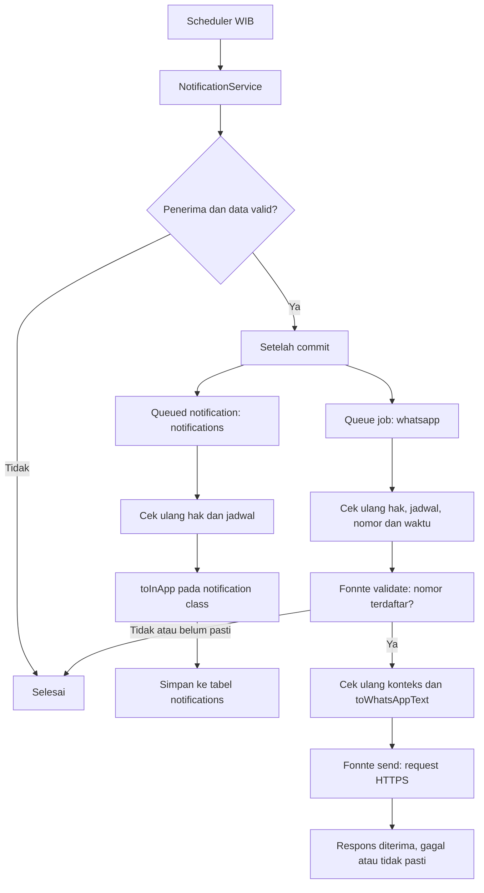

# Notifikasi operasional

Implementasi ini memakai scheduler Laravel, service orkestrasi dan dua antrean:
`notifications` untuk inbox dan `whatsapp` untuk Fonnte. Kedua pekerjaan
ditambahkan setelah transaksi database terluar commit. Rollback tidak mengantrekan
pekerjaan. Nomor dan token tidak disimpan dalam payload; isi pesan dan konteks
kebun berupa snapshot data di payload queue dan dapat tersimpan di `failed_jobs`.
Batasi akses dan retensi tabel queue sesuai kebutuhan.

## Alur



| Jenis | Waktu Asia/Jakarta | Penerima | Isi |
| --- | --- | --- | --- |
| Report Harian Kebun dari Petugas | 20:00 | Admin dan Owner aktif yang berhak pada tenant | Satu rekap seluruh kebun per penerima, tenant, dan tanggal, dari `FarmActivity` yang dilakukan Petugas pada hari itu sampai 20:00 WIB. Setiap kebun tanpa aktivitas Petugas menampilkan `Petugas belum mengisi aktivitas hari ini`. |
| Panen Reminder | 06:00 | Petugas aktif pada kebun yang ditugaskan | Siklus tanam aktif dengan tanggal panen tepat H-7, H-3 atau H-0. Tanpa jadwal yang cocok, tidak ada notifikasi. |

Pemilihan penerima memakai membership tenant dan Gate; pembacaan kebun dan
aktivitas memakai `visibleTo`. Semua aktivitas Petugas pada kebun digabungkan;
identitas aktivitas mengikuti catatan tersimpan, bukan assignment Petugas saat
ini. Nama yang tidak terlihat ditampilkan sebagai `Petugas tidak tersedia`.
Aktivitas Admin tidak ikut dalam rekap. Setiap kebun yang terlihat mendapat
bagian tersendiri dalam rekap tenant walaupun tidak memiliki Petugas yang
ditugaskan saat ini. Superadmin
tidak otomatis menjadi penerima bisnis.

Contoh: tenant dengan tiga kebun, satu Owner, dan satu Admin menghasilkan dua
report, bukan enam. Masing-masing penerima mendapat satu inbox dan satu percobaan
pengiriman WhatsApp yang berisi ketiga kebun (WhatsApp tetap mengikuti validasi
nomor dan retry). Owner dengan beberapa tenant mendapat rekap terpisah per tenant.
Tenant tanpa kebun yang terlihat tidak menghasilkan report kosong.

Kebun diurutkan berdasarkan nama dan ID. Setiap bagian menampilkan nomor urut,
nama kebun, serta aktivitasnya; WhatsApp juga menampilkan jumlah aktivitas dan
garis pemisah antar kebun. Pesan default hanya berlaku untuk bagian kebun yang
belum memiliki aktivitas. Data kebun atau aktivitas tenant lain tidak digabungkan.

## Mengelola konten

Halaman `/notifications` memiliki dua tab: **Belum dibaca** dan **Semua**.
Tab Belum dibaca menampilkan seluruh notifikasi pribadi yang belum dibaca lintas
tanggal dan tenant yang diizinkan, tanpa form filter. Tab Semua menyediakan filter
rentang tanggal diterima Dari?Sampai dalam WIB (default hari ini), dan pilihan tenant
khusus Owner. Perubahan filter langsung diterapkan; Reset pada tab Semua mengembalikan
rentang hari ini dan semua tenant. Setiap masuk atau memuat ulang halaman dimulai
dari tab Belum dibaca. Filter tidak disimpan di localStorage, session, atau URL browser.
Pagination tetap 15 notifikasi per halaman, sehingga seluruh notifikasi lama dapat
diakses tanpa pembatasan tanggal pada tab Belum dibaca.

Kedua tab mengelompokkan kartu berdasarkan tanggal diterima dalam WIB, dengan jarak
antar kelompok. Kartu awalnya tertutup dan menampilkan judul, waktu, indikator status,
serta nama tenant khusus Owner. Klik kartu untuk membuka detail; membuka detail tidak
menandai dibaca. Tombol Tandai dibaca tersedia di dalam detail dan mengeluarkan kartu
dari tab Belum dibaca setelah berhasil. Pagination dan tindakan ini mempertahankan tab aktif.

Filter diterapkan di backend setelah scope inbox pribadi dan sebelum pagination
serta total hasil. Rentang tanggal inklusif mengikuti `created_at`, bukan tanggal
panen/aktivitas: dari 00:00 WIB tanggal awal sampai sebelum 00:00 WIB setelah
tanggal akhir. Angka belum dibaca di header/bell tetap total inbox pribadi lintas
tanggal; jumlah hasil di atas daftar mengikuti filter. Admin/Petugas/Superadmin
tidak mendapat filter tenant; parameter tenant yang dipaksakan ditolak 403.

Nama tenant ditampilkan sebagai badge hanya pada kartu Owner. Template report
in-app dan WhatsApp hanya menyebut tenant bagi Owner; Admin menerima rekap kebun
tanpa label, nama, atau kalimat konteks tenant. Aturan presentasi ada di helper
`NotificationPolicy::showsTenantContext()` dan tidak memperluas grant mana pun,
termasuk bypass Superadmin. Channel/job memeriksa penerima terkini saat rendering.
Untuk inbox lama, header tenant yang dikenali disembunyikan pada respons Admin
tanpa menulis ulang isi tersimpan atau menghapus catatan aktivitas.

Hanya ada dua jenis notifikasi operasional:

| Jenis | Class pemilik teks |
| --- | --- |
| `daily_report` | `app/Notifications/DailyReportNotification.php` |
| `harvest_reminder` | `app/Notifications/HarvestReminderNotification.php` |

Ubah `toInApp()` pada class terkait untuk judul dan isi inbox. `toWhatsAppText()`
menentukan teks WhatsApp dengan judul dan label `*tebal*`, sapaan, serta baris
kosong antarbagian. Kebun dipisahkan dalam bagian bernomor, kemudian aktivitas
di dalamnya ditampilkan per blok berisi waktu, Petugas, dan catatan agar mudah
dibaca di ponsel.
In-app memakai format teksnya sendiri. Tidak ada channel email untuk kedua
notifikasi operasional ini.

Tanggal pesan menggunakan nama bulan Indonesia, misalnya `31 Oktober 2026`.
Timestamp inbox juga memakai nama bulan Indonesia dan tetap menampilkan jam WIB.
Locale diterapkan pada pemformatan notifikasi, tanpa mengubah locale global aplikasi.

Pesan WhatsApp diakhiri tautan detail sementara. Ganti konstanta `DETAIL_URL`
pada masing-masing class ketika URL halaman detail sudah tersedia: report memakai
`https://example.com/laporan-harian-kebun`, reminder memakai
`https://example.com/jadwal-panen`. Kedua URL ini placeholder, belum menuju
halaman aplikasi yang sebenarnya.

`NotificationService` hanya memilih penerima, mengambil data yang sudah diotorisasi,
menyiapkan snapshot, dan mengantrekan class yang sesuai setelah commit.
`InAppChannel` memanggil `toInApp()`. Job WhatsApp menerima objek notifikasi dan
memanggil `toWhatsAppText()` setelah pemeriksaan konteks dan nomor. Teks tidak
dibangun di service atau job.

Inbox memilih berdasarkan kolom `notifications.type`, bukan teks judul. Migrasi
mengisi jenis untuk row report/reminder lama yang judulnya dikenali. Mengubah
judul pada template tidak menyembunyikan histori yang sudah memiliki `type`.

Sebelum kedua channel melakukan efek, service memeriksa ulang penerima, hak,
tenant dan kebun. Reminder juga memeriksa assignment, status dan tanggal siklus.
Report tenant memeriksa ulang semua ID kebun dalam snapshot. Jika salah satu
kebun berpindah tenant, dihapus, atau tidak lagi terlihat, seluruh report yang
tertunda dilewati agar isi lama tidak membocorkan data. Data yang ditambahkan
setelah snapshot dibuat masuk pada report berikutnya, bukan mengubah snapshot.
Setelah tanggal WIB berganti, pekerjaan hari sebelumnya dilewati. Job WhatsApp
tidak memulai validasi dan pengiriman dalam 25 detik terakhir sebelum pergantian
hari. Sesudah validasi, job memeriksa konteks dan sisa 15 detik lagi. Perubahan
setelah request dimulai tidak dapat menarik kembali pesan yang sudah dikirim.

## Batas penyederhanaan

Tidak ada lagi `notification_deliveries` maupun command `pending`. Scheduler
tidak melakukan catch-up otomatis jika waktu utama terlewat; operator dapat
menjalankan command untuk hari yang sama. Pemanggilan manual tidak dibatasi
jam; scheduler tetap memakai 20:00 dan 06:00 WIB. Job yang sudah masuk
queue tetap diproses worker dan mengikuti kebijakan retry queue.

In-app menggunakan ID deterministik dan `insertOrIgnore`, sehingga job dengan
identitas yang sama tidak membuat dua baris inbox. Identitas report adalah jenis,
penerima, tenant, dan tanggal; identitas reminder tetap penerima, siklus, tanggal
panen, dan milestone. WhatsApp tidak memiliki
catatan deduplikasi persisten: menjalankan scheduler atau job berulang, atau
worker berhenti saat request berlangsung, **dapat mengirim WhatsApp ganda**.
Tidak ada status pengiriman WhatsApp permanen; log tersanitasi dan `failed_jobs`
dapat membantu diagnosis. Terdapat jendela setelah commit dan sebelum kedua job
berhasil dimasukkan ke queue; jika proses berhenti di sana, sebagian pekerjaan
dapat hilang. Pengingat untuk jadwal yang diubah setelah scheduler berjalan
tidak dibuat ulang otomatis; job tanggal lama dilewati saat dieksekusi.

Inbox menyimpan report yang sudah terbentuk. Log baru atau perubahan yang
ditambahkan setelah report pertama dibuat tidak memperbarui baris itu. Inbox
menampilkan dua jenis operasional melalui penanda `type`; data inbox lama lainnya
tetap tersimpan tetapi tidak muncul di halaman ini.

## WhatsApp dan konfigurasi

Atur placeholder di `.env` sesuai lingkungan tanpa memasukkan rahasia ke repo:

```dotenv
OPERATIONAL_NOTIFICATIONS_ENABLED=true
NOTIFICATION_QUEUE_CONNECTION=database
FONNTE_ENABLED=false
FONNTE_TOKEN=
```

WhatsApp nonaktif secara default. `phone_number` pada User opsional dan
dinormalisasi, misalnya `+62081212345678` atau `081212345678` menjadi
`6281212345678`. Nomor kosong atau tidak valid melewati WhatsApp; inbox tetap
berjalan. Nomor dapat diubah di profil atau User Management sesuai hak akses.

Sebelum mengirim, worker memanggil [API validate Fonnte](https://docs.fonnte.com/api-validate-number/)
dan hanya melanjutkan bila respons sukses boolean `status: true`, serta nomor
tujuan yang sama ada pada daftar `registered` dan tidak ada pada `not_registered`.
Nomor tidak terdaftar dilewati. Hasil kosong, ambigu, atau respons validasi gagal
tidak mengizinkan pengiriman. Validasi diulang saat retry, tanpa cache permanen.
Perubahan nomor, hak, atau jadwal selama validasi membuat job melewati pengiriman.
Gunakan satu consumer WhatsApp: dokumentasi provider menyebut validasi yang
berjalan bersamaan dapat mengganggu pemeriksaan sebelumnya. Tidak ada klaim
bahwa validasi menjamin pesan kelak diterima; registrasi nomor dapat berubah.

Fonnte memakai connect timeout 5 detik, timeout validasi 10 detik dan timeout
pengiriman 15 detik, dan tidak
mengikuti redirect. Respons hanya dianggap diterima provider jika HTTP sukses,
`status` boolean `true`, dan tepat satu ID valid. Ini belum membuktikan pesan
diterima atau dibaca pengguna. Penolakan sementara yang eksplisit, HTTP 429,
atau kegagalan DNS/koneksi sebelum submit dicoba ulang maksimal tiga attempt per
job dengan jeda 60 lalu 300 detik selama masih ada waktu. Penolakan permanen
dan hasil pengiriman yang tidak pasti gagal tanpa retry otomatis. Validasi yang
timeout atau responsnya tidak lengkap boleh diulang karena belum mengirim pesan;
konfigurasi sertifikat TLS yang bermasalah gagal permanen. Setiap attempt job
dapat memanggil satu validasi dan satu pengiriman. Error dan log tidak
mencatat nomor, token atau isi pesan; payload queue tetap memuat isi pesan.

## Menjalankan worker dan scheduler

Migrasikan hanya database yang sesuai lingkungan setelah memeriksa statusnya.
Jangan menjalankan reset atau migrasi destruktif pada database non-demo.

```shell
php artisan migrate
php artisan queue:work database --queue=notifications,whatsapp --sleep=1 --tries=3 --timeout=30 --max-time=3600
```

Untuk pengembangan, jalankan `php artisan schedule:work` dalam proses lain.
Di Linux production gunakan cron tiap menit untuk `php artisan schedule:run`
dan process manager seperti systemd atau Supervisor untuk worker. Di Windows,
gunakan Task Scheduler tiap menit untuk `php artisan schedule:run` dan jalankan
worker sebagai service yang dapat restart. Pastikan working directory dan PHP
executable benar. Di Windows, perilaku hard timeout worker berbeda karena tidak
ada PCNTL; HTTP timeout tetap berlaku. Pastikan `retry_after` antrean lebih besar
dari timeout worker. Setelah deployment atau perubahan konfigurasi, rebuild
config cache bila digunakan dan restart worker dengan `php artisan queue:restart`.

Pada upgrade refaktor ini, selesaikan antrean versi lama dengan kode lama sebelum
mengganti kode dan memulai worker baru. Payload lama memakai class generik
`OperationalNotification` atau array job lama dan tidak dikonversi otomatis.
Jangan menghapus antrean atau mengulang `failed_jobs` tanpa memeriksa riwayat
pengiriman; job WhatsApp dapat menimbulkan pesan ganda.

Setelah perubahan report menjadi per tenant, job report per kebun yang masih
tertunda ditolak oleh pemeriksaan snapshot. Buat ulang report dengan command
manual bila diperlukan, dengan mempertimbangkan kemungkinan WhatsApp sebelumnya
sudah terkirim. Histori inbox yang sudah tersimpan tidak ditulis ulang.

Command manual pada hari yang sama:

```shell
php artisan notifications:dispatch daily-report
php artisan notifications:dispatch harvest-reminder
```

Jangan menjalankan command berulang tanpa mempertimbangkan risiko WhatsApp
ganda. Pengujian provider/perangkat nyata hanya dilakukan dengan instruksi
pengguna dan target yang disetujui.

## Skema

Migrasi `2026_10_31_000001_add_phone_number_to_users` menambahkan nomor nullable,
maksimum 15 karakter. Rollback menolak menghapus kolom jika ada nomor tersimpan.
Migrasi `2026_10_31_000002_add_type_to_notifications` menambahkan penanda jenis
dan indeks inbox pada tabel yang sudah ada. Tidak ada tabel outbox.

Migrasi `2026_10_31_000003_add_team_id_to_notifications` menambahkan FK nullable
`team_id` dan indeks untuk pemilihan tenant. Metadata baru berasal dari snapshot
yang sudah diotorisasi. Backfill report lama hanya dilakukan jika UUID deterministik
per penerima/tenant/tanggal cocok secara tepat dengan membership yang tersimpan;
nama pada teks pesan tidak digunakan untuk menebak tenant. Histori yang tidak
bisa dipastikan tetap tersimpan dengan metadata null: terlihat di Semua tenant,
tetapi tidak dicocokkan ke salah satu tenant tertentu. Identitas record, isi,
status dibaca dan waktu histori tetap dipertahankan.

## Referensi kode

- [Audit dan optimasi query notifikasi](notification-query-performance.md), termasuk pengukuran N+1, batas snapshot membership, dan tes pertumbuhan query.
- [NotificationService](../app/Services/Notifications/NotificationService.php)
- [DailyReportNotification](../app/Notifications/DailyReportNotification.php), [HarvestReminderNotification](../app/Notifications/HarvestReminderNotification.php), dan [InAppChannel](../app/Notifications/Channels/InAppChannel.php)
- [SendWhatsAppNotification](../app/Jobs/SendWhatsAppNotification.php) dan [FonnteClient](../app/Services/Notifications/FonnteClient.php)
- [Scheduler](../routes/console.php), [konfigurasi](../config/operational_notifications.php), dan [inbox](../app/Services/Notifications/NotificationInboxService.php)
- [Pengujian notification](../tests/Feature/Notifications)

## Verifikasi terakhir

Suite penuh setelah optimasi query notifikasi: 405 lulus, 1 dilewati karena fitur Fortify
2FA tidak aktif, dengan 8.506 assertions. Cakupan mencakup template kedua jenis, inbox personal, metadata
jenis, commit/rollback, worker database, validasi registrasi nomor, respons provider
gagal, retry terbatas, perubahan jadwal dan batas waktu. Pint, PHPStan untuk kode
runtime yang berubah, serta build frontend lulus. Build masih memunculkan warning
opsional `fontaine` dan chunk `Laporan` yang besar.

Cakupan rekap tenant meliputi tiga kebun dalam satu pesan per penerima, bagian
kebun kosong, Owner multi-tenant, isolasi Admin, identitas inbox berulang,
perpindahan kebun, membership dicabut, payload per kebun lama, tenant tanpa kebun,
serta rollback/commit snapshot melalui worker database nyata.

Cakupan filter meliputi default belum dibaca lintas tanggal, batas hari WIB pada tab Semua, kombinasi
tanggal/tenant sebelum pagination, reset saat masuk ulang, penolakan filter
tenant lintas membership atau dari non-Owner, validasi tanggal, dan backfill yang
tidak menebak dari teks. Pemeriksaan browser sebelumnya mencakup Admin/Owner/Petugas/inbox
kosong di lebar 320, 390, 430, dan 1280 pada tema terang/gelap. Alur status,
rentang tanggal, tenant, pagination, read, serta reset saat reload diuji pada
database browser khusus tes. Grid memakai lebar container agar field tanggal
tetap terbaca pada layout Owner yang sempit di desktop.

Tes query memastikan jumlah query tetap saat jumlah kartu bertambah dari 1 ke 15,
kebun dari 1 ke 8, serta siklus panen dari 1 ke 30. Snapshot membership dibuang
setelah operasi dan divalidasi ulang pada pemanggilan job berikutnya, termasuk
ketika membership, assignment, status aktif, atau role berubah selama request
validasi Fonnte. Detail pengukuran dan batas kesimpulan tersedia pada
[audit query](notification-query-performance.md).

Provider menggunakan respons tiruan selama pengujian; tidak ada panggilan
validasi/pengiriman nyata atau restart worker lingkungan aplikasi. Migrasi
metadata tenant sudah diterapkan pada database lokal setelah memverifikasi
environment local/development dan koneksi loopback. Pesan, status dibaca dan
identitas histori tidak diubah. File `.env` tidak diedit.
