# Panduan Penggunaan Admin dan Petugas

**Sistem Manajemen Lahan Bumi Hijauan**  
Versi 1.0 · 19 November 2026

Panduan ini menjelaskan alur awal Admin menyiapkan akun dan data lahan, lalu alur Petugas mencatat pekerjaan melalui perangkat mobile. Gunakan istilah **lahan** untuk lokasi usaha pertanian; satu lahan dapat dibagi menjadi blok, lalu subblok untuk area tanam dan siklus yang berbeda.

> **Cara membaca:** judul besar menandai bagian utama, subjudul menandai tahapan dalam bagian, daftar bernomor menunjukkan urutan kerja, dan bullet menunjukkan pilihan atau hal yang perlu diperhatikan.
> **Cakupan:** panduan berfokus pada Admin dan Petugas/PIC. Owner dan Superadmin dijelaskan untuk konteks akun serta batas peran. Label menu dapat berubah mengikuti pembaruan aplikasi.

## 1. Istilah dan peran

| Istilah | Arti dalam panduan |
| --- | --- |
| Owner | Pemilik usaha, dalam briefing ini Pak Satar. Memantau ringkasan usaha dan data yang menjadi hak aksesnya. |
| Superadmin | Developer atau personel yang diberi tanggung jawab mengelola akses lintas tenant dan dukungan sistem. |
| Admin | Pengurus operasional satu tenant yang menyiapkan akun, data lahan, SOP, blok, dan penugasan. |
| Petugas / PIC | Person in Charge di lapangan. Mengerjakan tugas dan mengirim laporan dari lahan yang ditugaskan. |
| Lahan | Lokasi usaha pertanian dengan identitas, luas, wilayah, titik peta, status penguasaan, dan target hasil. |
| Blok | Pembagian area di dalam lahan. Blok dapat memiliki komoditas dan SOP budidaya. |
| Subblok | Bagian blok yang disiapkan untuk satu rencana atau siklus tanam. Buat subblok sebelum memulai penanaman pada bagian tersebut. |
| SOP | Prosedur operasional budidaya yang disusun Admin. Tahap SOP menjadi dasar tugas yang ditampilkan kepada Petugas. |
| Tenant / tim | Ruang kerja organisasi yang membatasi data yang dapat dilihat dan dikelola pengguna. |

### Ringkasan tanggung jawab

| Peran | Tanggung jawab utama |
| --- | --- |
| Superadmin | Menyiapkan atau mendukung akun utama, menjaga konfigurasi akses, dan membantu Admin. Hak global hanya untuk kebutuhan pengelolaan sistem. |
| Admin | Membuat akun Admin/Petugas dalam tenant, mencatat lahan, menyusun SOP, membuat blok dan subblok, menugaskan Petugas, serta memantau laporan. |
| Petugas / PIC | Melihat lahan dan tugas yang ditugaskan, mencatat aktivitas atau realisasi tugas, serta meninjau laporan yang pernah dikirim. |
| Owner | Memantau ringkasan usaha dan informasi yang tersedia sesuai aksesnya. |

## 2. Persiapan dan masuk ke aplikasi

### Akses

- Alamat aplikasi demo: [Buka halaman masuk](https://farmer.icdigital.io/login).
- Gunakan akun yang diberikan organisasi. Empat alamat akun demo untuk lingkungan lokal tercatat di [Daftar akun demo dan informasi akses](demo-seed-credentials.md).
- Akun dengan alamat `@farmer-ic.test` adalah fixture demo/pengembangan, bukan akun untuk layanan bersama atau operasional.
- Jangan menyalin kata sandi ke dokumen panduan, pesan grup, atau dokumen yang dapat diakses publik. Bagikan melalui kanal aman dan ubah kata sandi sesuai kebijakan organisasi.

### Masuk

1. Buka halaman masuk melalui browser. Tampilan menyesuaikan ukuran layar desktop atau mobile.
2. Isi email dan kata sandi akun yang diberikan.
3. Pilih **Log in**. Jika kredensial tidak cocok, periksa ejaan email, Caps Lock, dan pastikan akun belum dinonaktifkan.
4. Setelah berhasil masuk, aplikasi mengarahkan pengguna ke area yang sesuai dengan perannya.

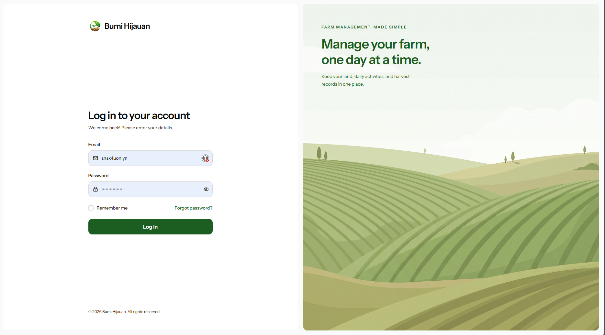

*Gambar 1A. Halaman masuk pada layar desktop.*

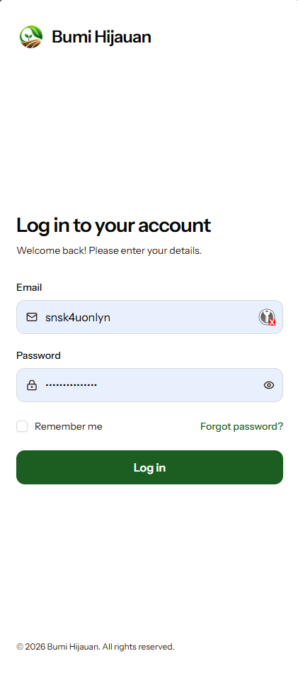

*Gambar 1B. Halaman masuk pada layar mobile.*

## 3. Alur awal Admin: buat akun Petugas

Admin perlu masuk terlebih dahulu sebelum menyiapkan akun lapangan. Akun Petugas baru dapat ditautkan ke lahan yang sudah tercatat; jika lahannya belum ada, buat akun dahulu lalu lakukan penugasan setelah lahan tersedia.

1. Buka menu **Manajemen Pengguna**. Tabel ini menampilkan akun yang sudah ada dan tombol untuk menambahkan akun (Gambar 2).

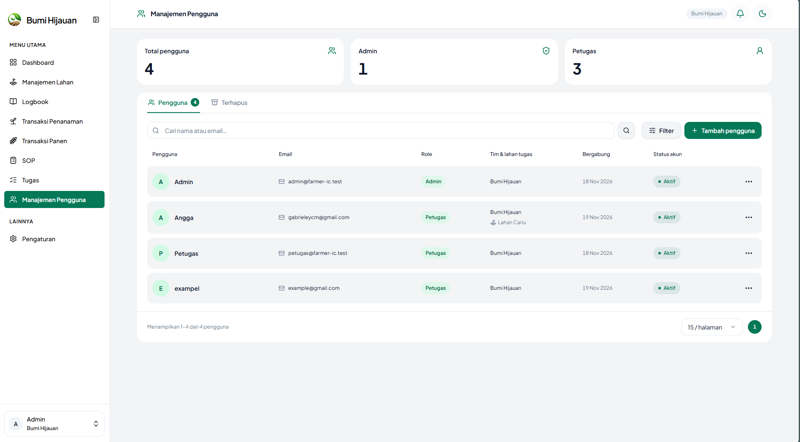

*Gambar 2. Daftar pengguna. Periksa nama, email, peran, tenant, status, dan penugasan sebelum memilih tindakan.*

2. Pilih **Tambah pengguna**. Form pembuatan akun akan terbuka (Gambar 3).

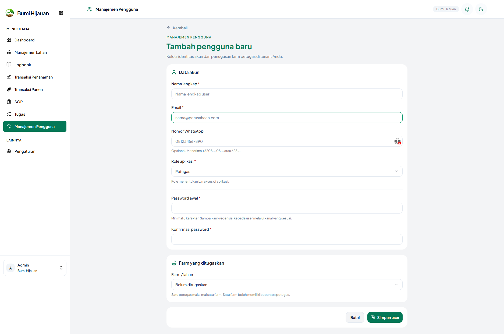

*Gambar 3. Form tambah pengguna. Lengkapi identitas, peran, kata sandi awal, dan penugasan lahan jika sudah tersedia.*

3. Isi nama lengkap, email aktif, dan nomor WhatsApp bila tersedia.
4. Pilih peran aplikasi **Petugas**. Admin dapat membuat akun Admin atau Petugas sesuai kewenangannya; pengaturan Superadmin hanya dilakukan personel yang berwenang.
5. Tetapkan kata sandi awal dan isi konfirmasinya. Berikan kredensial kepada pengguna melalui kanal aman.
6. Jika lahan sudah tersedia, pilih lahan untuk penugasan Petugas. Jika belum tersedia, simpan tanpa penugasan dan kembali setelah lahan dibuat.
7. Tinjau kembali data lalu simpan. Pastikan pengguna muncul pada daftar dan peran serta penugasannya benar.

**Praktik yang disarankan:** satu akun untuk satu orang, email tidak digunakan bersama, dan akun Petugas diberi penugasan lahan yang benar. Penugasan membatasi data operasional yang tersedia untuk Petugas. Pada model saat ini satu akun Petugas memiliki paling banyak satu lahan tugas; satu lahan dapat ditugaskan kepada beberapa Petugas.

### Mengelola akun yang sudah dibuat

- Gunakan pencarian nama/email dan filter untuk menemukan akun. Menu tindakan di ujung baris membuka opsi detail, ubah, dan hapus sesuai izin (Gambar 4).

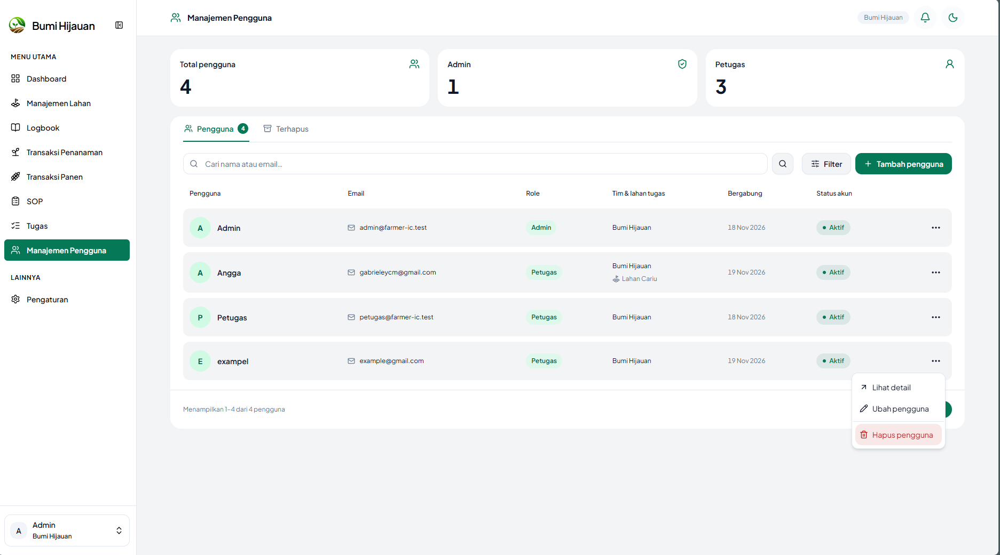

*Gambar 4. Menu tindakan pengguna. Pilih tindakan pada akun yang benar.*

- Buka **Lihat detail** untuk memeriksa identitas, peran, tenant, dan lahan tugas (Gambar 5).

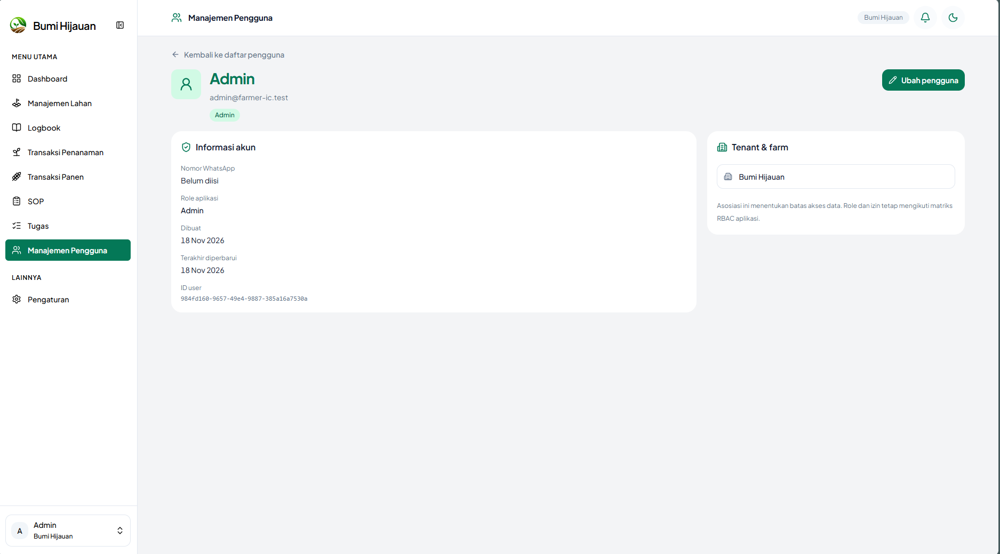

*Gambar 5. Detail pengguna menampilkan informasi akun dan lahan yang ditugaskan.*

- Pilih **Ubah pengguna** untuk memperbarui informasi yang diizinkan (Gambar 6). Admin tenant tidak dapat mengganti peran akun yang telah ada; perubahan tersebut ditangani Superadmin.

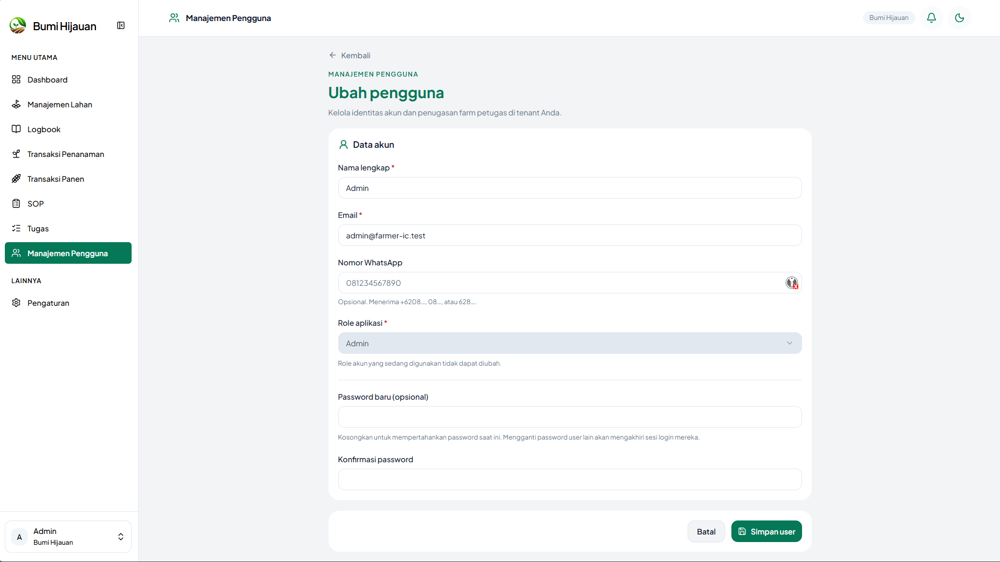

*Gambar 6. Form ubah pengguna. Isian kata sandi boleh dikosongkan jika tidak ingin menggantinya.*

- Kata sandi baru pada formulir edit bersifat opsional. Mengubahnya dapat mengakhiri sesi aktif pengguna lain.
- **Hapus pengguna** meminta konfirmasi (Gambar 7). Penghapusan menonaktifkan kemampuan masuk, sementara akun dan relasi operasional dipertahankan melalui soft delete.

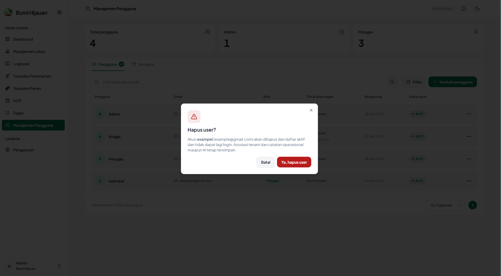

*Gambar 7. Pastikan akun yang ditampilkan benar sebelum mengonfirmasi penghapusan.*

- Pengguna yang dihapus tersedia pada tab **Terhapus** bagi Admin yang berwenang (Gambar 8). Pilih **Pulihkan** untuk mengaktifkan kembali akun.

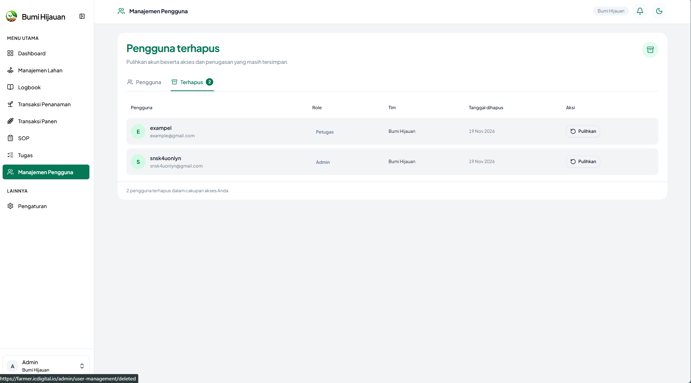

*Gambar 8. Tab Terhapus menampilkan akun yang dapat dipulihkan oleh Admin yang berwenang.*

Setelah memilih **Pulihkan**, tinjau dialog konfirmasi (Gambar 9), lalu periksa kembali status dan penugasan akun.

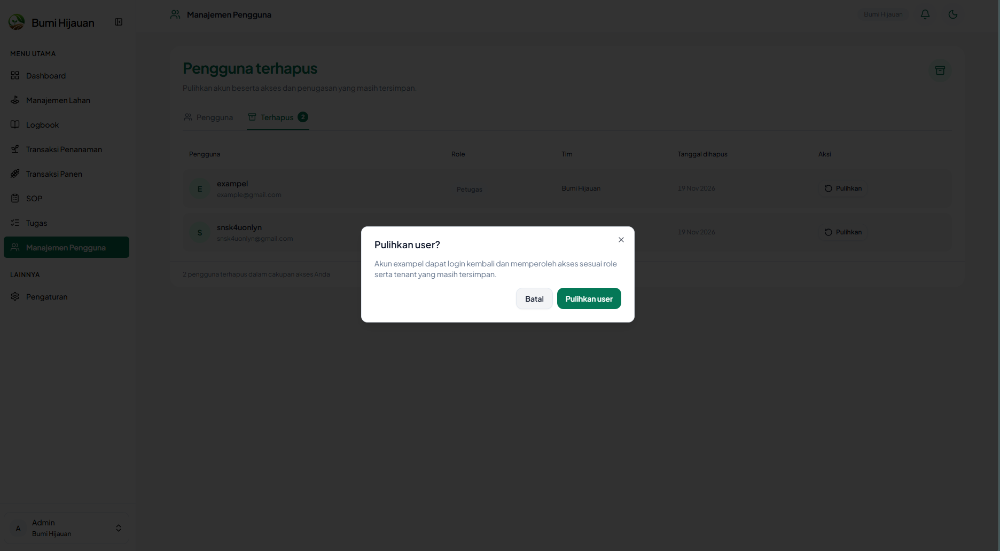

*Gambar 9. Konfirmasikan pemulihan akun yang dipilih.*

## 4. Mencatat lahan

Buka **Manajemen Lahan**, lalu pilih **Tambah lahan**. Isi informasi berdasarkan dokumen dan kondisi lapangan. Isian bertanda bintang wajib dilengkapi.

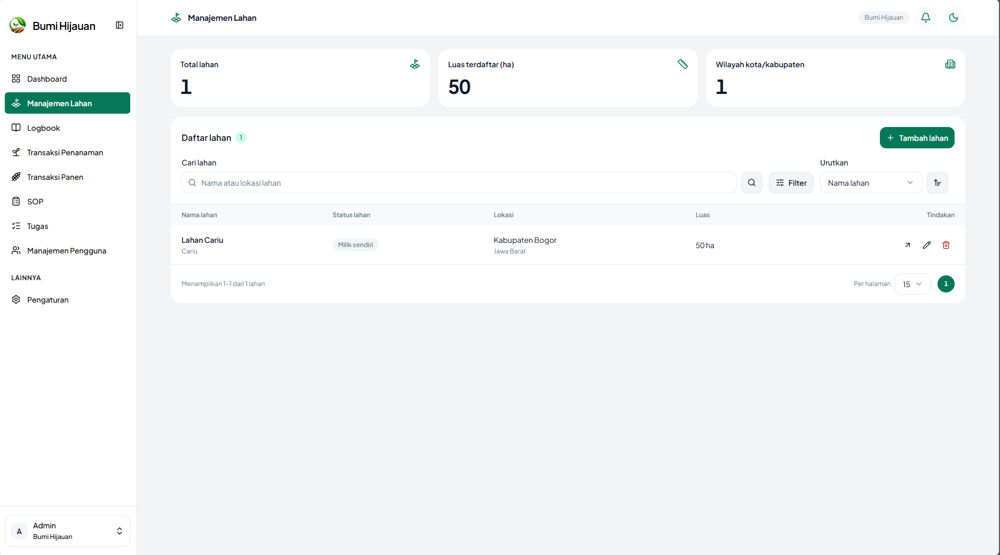

*Gambar 10. Daftar Manajemen Lahan. Gunakan pencarian atau filter untuk menemukan lahan; pilih **Tambah lahan** untuk mencatat lahan baru.*

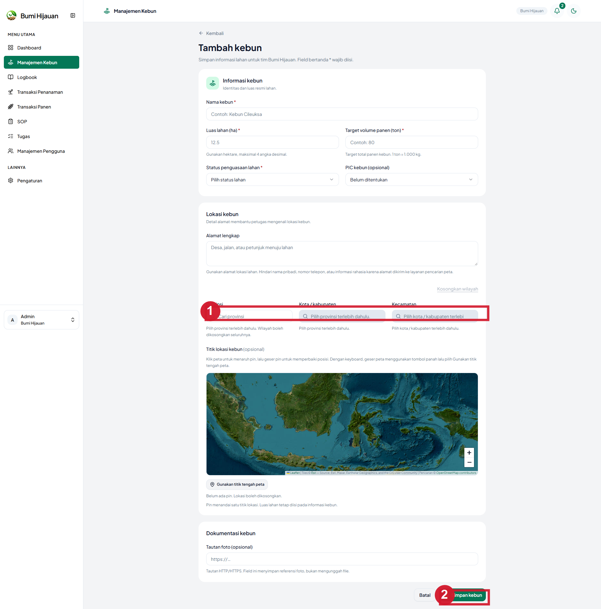

*Gambar 11. Pilih wilayah secara berurutan, lalu simpan setelah data diperiksa.*

### Informasi lahan

| Isian | Cara mengisi |
| --- | --- |
| Nama lahan | Gunakan nama yang singkat dan mudah dikenali, misalnya “Lahan Cariu”. Hindari nama yang sama dalam satu ruang kerja. |
| Luas lahan (ha) | Masukkan luas resmi/terverifikasi dalam hektare. Perhatikan satuan; 1 ha = 10.000 m². |
| Target volume panen (ton) | Masukkan target total sesuai rencana usaha. Jika target dihitung dari luas × produktivitas per hektare, pastikan komoditas, satuan, periode, dan angka produktivitas disepakati terlebih dahulu. Form meminta nilai target secara langsung. |
| Status penguasaan lahan | Pilih Milik sendiri, Sewa, atau Kerja sama sesuai dokumen. Untuk Sewa/Kerja sama, catat pihak terkait jika diminta. |
| PIC lahan | Opsional. Pilih akun Petugas yang telah tersedia. Penugasan dapat dilakukan atau diperbarui kemudian. |

### Lokasi dan dokumentasi

1. Tulis alamat yang membantu menemukan lokasi, termasuk desa/dusun atau petunjuk akses. Hindari memasukkan nomor telepon atau data pribadi pada alamat.
2. Pilih **Provinsi**, kemudian **Kota/kabupaten**, lalu **Kecamatan**. Pilihan wilayah berikutnya aktif setelah pilihan sebelumnya tersedia.
3. Gunakan peta untuk menaruh pin, lalu geser marker jika posisinya perlu dikoreksi. Periksa posisi terhadap alamat sebelum menyimpan. Pin menunjukkan satu titik referensi; pin bukan batas/poligon luas lahan.
4. Tautan dokumentasi menerima referensi HTTP/HTTPS, misalnya folder Google Drive. Isian tautan ini menyimpan URL, bukan mengunggah berkas. Pastikan izin akses folder sudah sesuai bagi tim yang membutuhkan.
5. Simpan lahan dan buka detailnya untuk memastikan luas, wilayah, status, PIC, dan titik lokasi benar.

## 5. Membagi lahan menjadi blok dan subblok

### Tambahkan blok

1. Dari detail lahan, pilih **Tambah blok**. Gambar 12 menunjukkan letak aksi Tambah blok dan Tambah subblok.

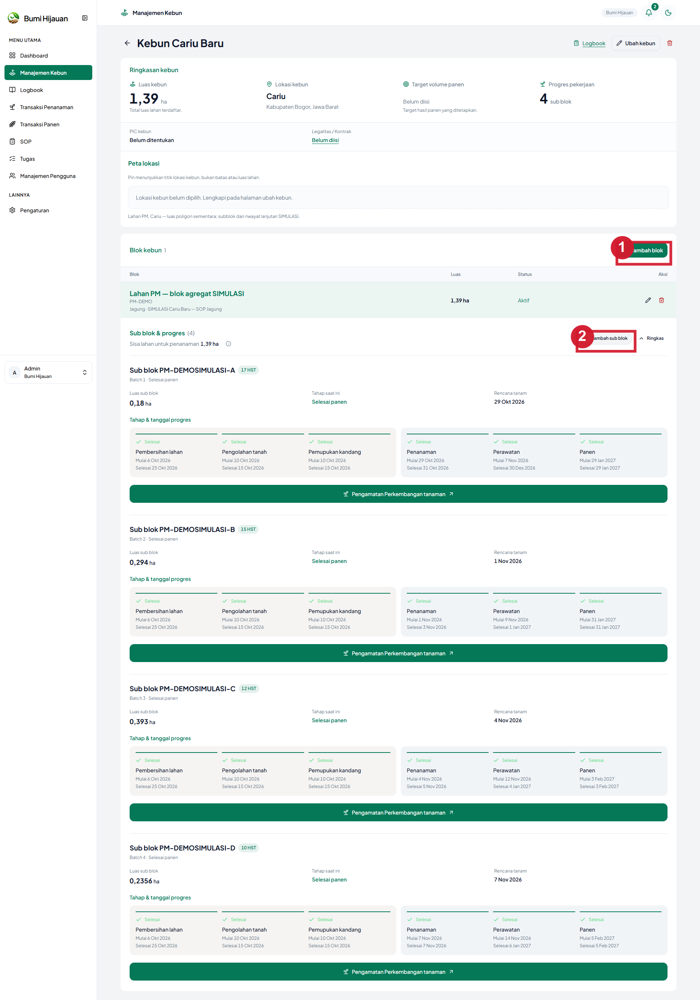

*Gambar 12. Detail lahan; gunakan Tambah blok untuk memulai pembagian lahan.*

2. Pilih **Komoditas blok** terlebih dahulu. Pilihan SOP default mengikuti komoditas yang tersedia.
3. Pilih SOP yang sesuai. Jika SOP belum tersedia, Admin perlu menyusun SOP untuk komoditas tersebut sebelum memasangnya pada blok.
4. Isi kode blok yang unik di lahan tersebut, misalnya `B01`, dan nama deskriptif, misalnya **Blok Utara**.
5. Masukkan luas blok dan pilih satuan luas yang benar. Rencanakan pembagian luas agar jumlah blok aktif tidak melebihi kapasitas lahan. Pembagian sama rata hanya salah satu cara perencanaan, bukan aturan wajib.
6. Pastikan status **Aktif** bila blok akan digunakan untuk kegiatan operasional. Catatan bersifat opsional.
7. Simpan dan periksa blok di halaman detail lahan.

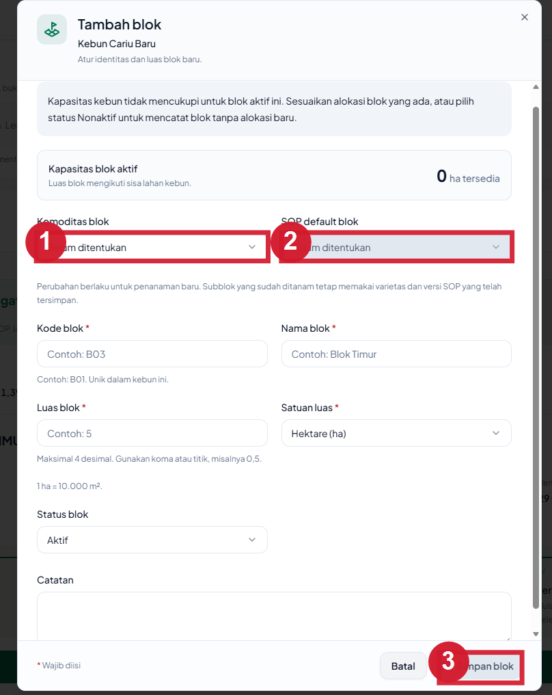

*Gambar 13. Form tambah blok. Pilih komoditas dan SOP, lalu lengkapi kode, nama, luas, serta satuan. Pada tangkapan layar, kapasitas lahan untuk blok aktif adalah 0 ha sehingga Simpan blok nonaktif; sesuaikan alokasi atau status blok sebelum menyimpan.*

### Tambahkan subblok

1. Pada blok yang tepat, pilih **Tambah subblok**. Form yang terbuka ditunjukkan pada Gambar 14.
2. Isi label bila diperlukan; jika dikosongkan, sistem dapat memberi label otomatis.
3. Isi rencana tanggal tanam bila sudah diketahui. Tanggal ini adalah rencana, bukan bukti bahwa penanaman sudah terjadi.
4. Periksa sisa luas yang tersedia pada blok, lalu simpan.
5. Setelah subblok tersedia, Petugas dapat menjalankan alur penanaman untuk bagian tersebut. Aktivitas persiapan tertentu, seperti pembersihan lahan, dapat dicatat pada tingkat blok sesuai alur aplikasi.

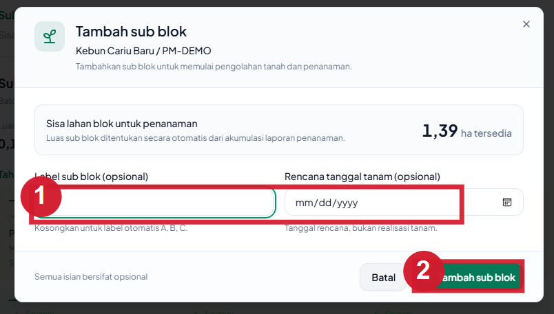

*Gambar 14. Label dan rencana tanggal tanam bersifat opsional pada contoh form. Tekan Tambah subblok setelah memastikan sisa luas mencukupi.*

### SOP dan tugas

Admin menyusun langkah SOP dan mengaitkannya dengan komoditas. SOP yang dipasang pada blok menjadi acuan tahapan kerja; tugas yang relevan muncul pada area **Tugas** Petugas. Tugas dapat terkait siklus tanam/subblok. Jika jadwal, komoditas, atau penugasan berubah, Admin meninjau konfigurasi SOP dan tugas agar instruksi lapangan tetap sesuai.

1. Buka menu **SOP** dan pastikan komoditas memiliki SOP yang sesuai. Daftar SOP ditunjukkan pada Gambar 15.

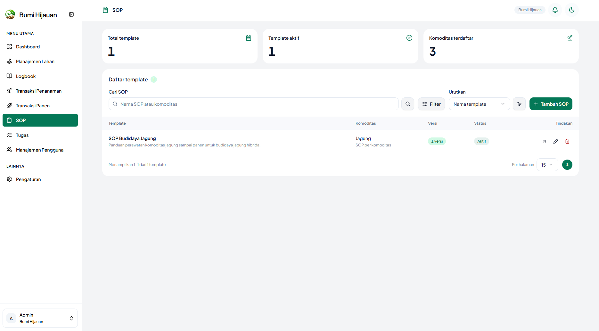

*Gambar 15. Daftar SOP. Pastikan SOP tersedia untuk komoditas sebelum memilihnya pada blok.*

2. Jika belum tersedia, pilih tambah SOP dan isi identitas serta komoditas (Gambar 16).

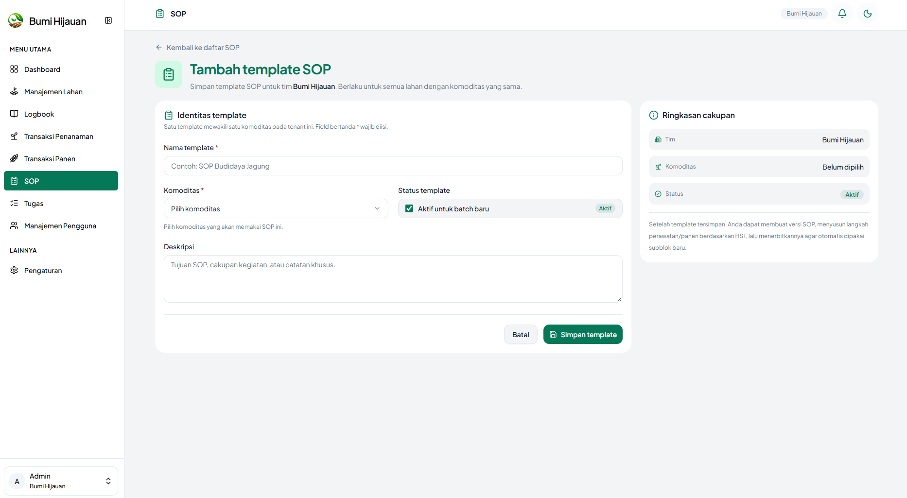

*Gambar 16. Form tambah SOP. Isi identitas dan komoditas SOP, lalu simpan sebelum menambahkan langkah.*

3. Buka detail SOP yang dibuat untuk meninjau status dan mengelola langkah (Gambar 17).

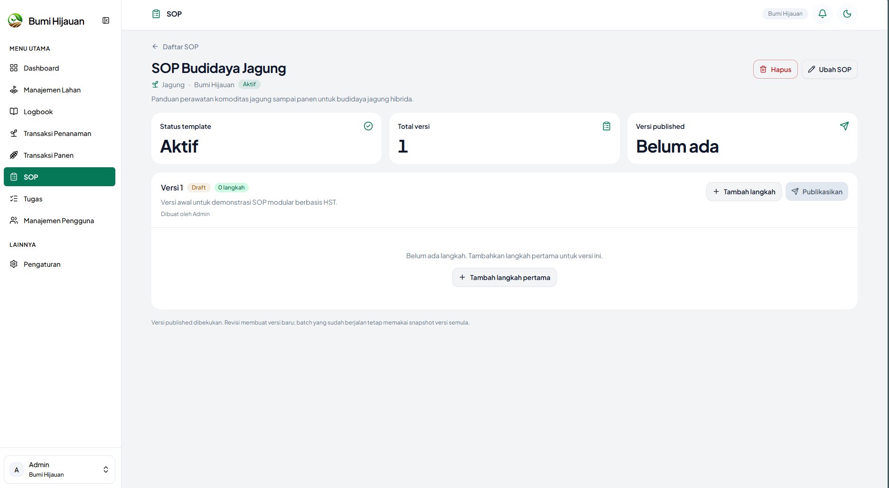

*Gambar 17. Detail SOP dan area untuk meninjau atau menambahkan langkah.*

4. Tambahkan langkah secara berurutan, termasuk waktu relatif terhadap HST, instruksi, dan bukti yang diminta (Gambar 18).

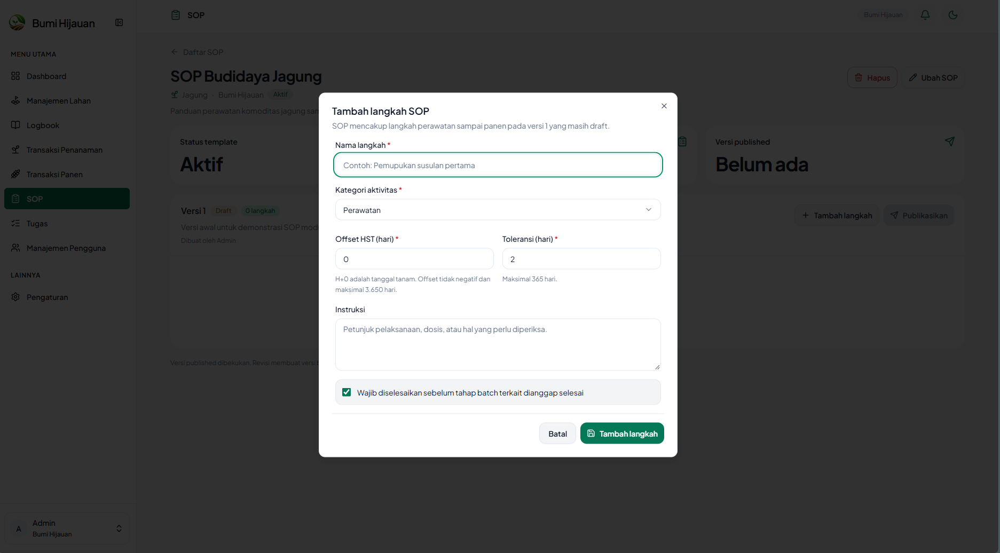

*Gambar 18. Form tambah langkah SOP.*

## 6. Alur kerja Petugas/PIC di mobile

### Beranda

Beranda menampilkan ringkasan batch pra-tanam, penanaman, dan panen, serta bagian **To-do hari ini**. Gunakan angka ringkasan dan daftar tugas sebagai petunjuk kerja; bila tugas tidak muncul, periksa penugasan lahan dan filter tugas bersama Admin.

### Lihat lahan tugas

1. Buka tab **Lahan**.
2. Pilih lahan yang ditugaskan untuk melihat alamat/wilayah, luas, peta titik lokasi, blok, subblok, dan ringkasan progres.
3. Gunakan detail blok atau subblok untuk memastikan pekerjaan dilaporkan pada area yang benar.

### Kerjakan tugas SOP

1. Buka tab **Tugas** dan periksa tugas terlambat, hari ini, atau mendatang.
2. Gunakan pencarian dan filter blok, status tindakan, atau kategori untuk menemukan tugas.
3. Buka detail tugas dan baca instruksi sebelum bekerja.
4. Setelah pekerjaan selesai, catat aktivitas/laporan yang diminta dan selesaikan tugas sesuai kontrol yang tersedia. Jika tugas tidak dapat dikerjakan, sampaikan alasan kepada Admin agar penjadwalan atau status ditangani dengan benar.

### Catat aktivitas mandiri

Gunakan tombol **+** pada Beranda/Laporan untuk pekerjaan yang dilakukan di luar daftar to-do SOP. Pilih kategori yang paling sesuai, isi tanggal/waktu, lahan atau blok yang relevan, jumlah pekerja dan rincian kegiatan yang diminta. Periksa isian sebelum mengirim, lalu pastikan aktivitas muncul pada riwayat laporan.

### Lihat laporan

1. Buka tab **Laporan** untuk melihat aktivitas yang sudah dicatat.
2. Cari berdasarkan aktivitas atau subblok, kemudian gunakan filter tanggal, kategori, atau sumber bila diperlukan.
3. Buka suatu baris untuk melihat detail laporan. Jika laporan tidak ditemukan, hapus filter yang tidak diperlukan dan periksa tanggal kerja.

## 7. Daftar periksa sebelum selesai

### Admin

- [ ] Akun dibuat dengan email unik dan peran yang tepat.
- [ ] Petugas ditugaskan ke lahan yang sesuai.
- [ ] Luas, target, status penguasaan, wilayah, dan titik peta sudah diperiksa.
- [ ] Kode blok unik, komoditas dan SOP sesuai, luas serta satuan benar.
- [ ] Subblok dibuat sebelum penanaman pada bagian tersebut.
- [ ] Petugas mengetahui cara masuk dan mendapat kredensial melalui kanal aman.

### Petugas

- [ ] Lahan dan blok yang dipilih sesuai pekerjaan.
- [ ] Tanggal kerja dan kategori aktivitas benar.
- [ ] Rincian wajib diisi dan laporan dikirim.
- [ ] Aktivitas terlihat pada riwayat atau terhubung ke tugas yang sesuai.
- [ ] Kendala/insiden disampaikan kepada Admin bila memerlukan tindak lanjut.

## 8. Pemecahan masalah

| Situasi | Langkah awal |
| --- | --- |
| Tidak bisa masuk | Periksa email/kata sandi dan status akun. Hubungi Admin untuk pemeriksaan akun atau reset kredensial. |
| Menu tidak terlihat | Pastikan akun menggunakan peran dan tenant yang benar. Minta Admin memeriksa akses; jangan menggunakan akun orang lain. |
| Petugas tidak melihat lahan | Periksa penugasan lahan pada detail akun dan pastikan lahan berada di tenant yang sama. |
| Pilihan SOP kosong | Periksa apakah SOP sudah dibuat, aktif/tersedia, dan sesuai komoditas yang dipilih. |
| Wilayah atau titik peta keliru | Perbaiki pilihan provinsi-kota/kabupaten-kecamatan dan geser pin sebelum menyimpan perubahan. |
| Aktivitas tidak ada di laporan | Hapus filter, periksa tanggal kerja, lalu pastikan pengiriman berhasil. Hubungi Admin jika tetap tidak muncul. |
| Lahan tidak memiliki blok/subblok | Admin membuat blok terlebih dahulu, kemudian subblok untuk area yang akan ditanam. |

## 9. Indeks visual untuk materi pelatihan

Tangkapan layar yang tersedia sudah disisipkan pada langkah yang relevan. Gambar dengan penanda merah menyorot kontrol yang perlu digunakan. Gambar lain dalam daftar berikut belum tersedia sebagai berkas; tambahkan tangkapan layar terbaru dari lingkungan yang disetujui saat materi tersebut tersedia.

| ID visual | Layar yang ditunjukkan | Bagian panduan |
| --- | --- | --- |
| 1A–1B | Halaman masuk desktop dan mobile | 2; Gambar 1A–1B |
| 2 | Beranda Admin setelah masuk | 2–3 |
| 3–4D | Daftar pengguna, menu aksi, konfirmasi hapus, akun terhapus, pemulihan | 3; Gambar 2, 4, 7–9 |
| 5–7 | Form akun baru, detail pengguna, form ubah pengguna | 3; Gambar 3, 5–6 |
| 8–9B | Daftar lahan, form lahan, contoh pengisian, detail sebelum blok dibuat | 4; Gambar 10–11 |
| 9C–9D | Form blok dan detail lahan setelah blok ditambahkan | 5; Gambar 12–13 |
| 9E–9F | Form subblok dan detail lahan dengan subblok/progres | 5; Gambar 14 |
| SOP | Daftar, detail, pembuatan SOP dan langkah SOP | 5; Gambar 15–18 |
| 10–10B | Beranda Petugas dan pilihan aktivitas mandiri | 6 |
| 11 | Lahan tugas pada tampilan mobile | 6 |
| 12 | Daftar tugas Petugas | 6 |
| 13 | Riwayat laporan Petugas | 6 |

## 10. Catatan pengelolaan dokumen

Panduan ini menjelaskan alur Admin–Petugas dan menghindari pencantuman kata sandi. Untuk perubahan alur, menu, atau aturan akses, perbarui bagian terkait dan indeks visual bersamaan. Gunakan tangkapan layar tanpa data pribadi nyata; samarkan email, nomor telepon, koordinat sensitif, dan nama pihak bila dokumen dibagikan di luar tim.

## 11. Penutup

Terima kasih telah menggunakan panduan ini. Pastikan data lahan dan penugasan diperiksa sebelum pekerjaan dimulai, lalu catat aktivitas sesuai kondisi lapangan dan SOP yang berlaku.

