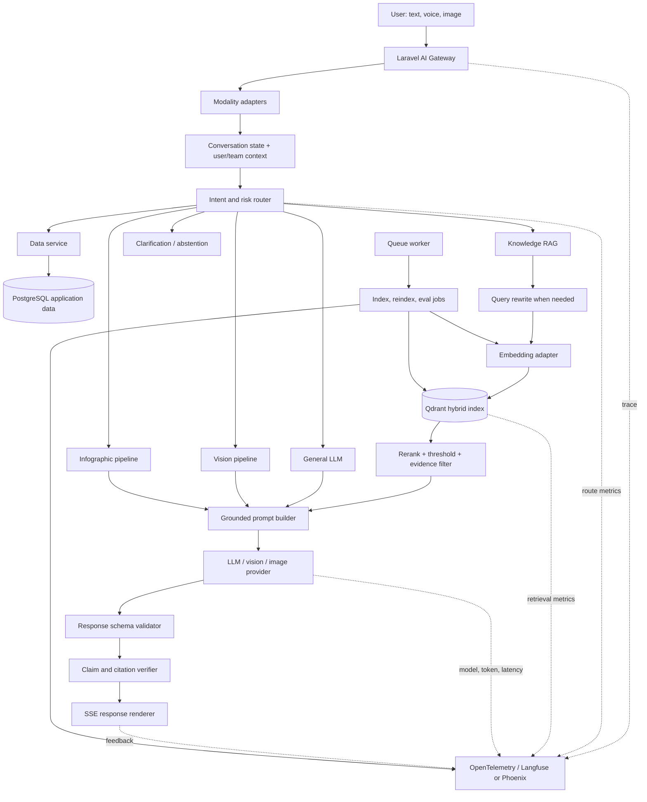
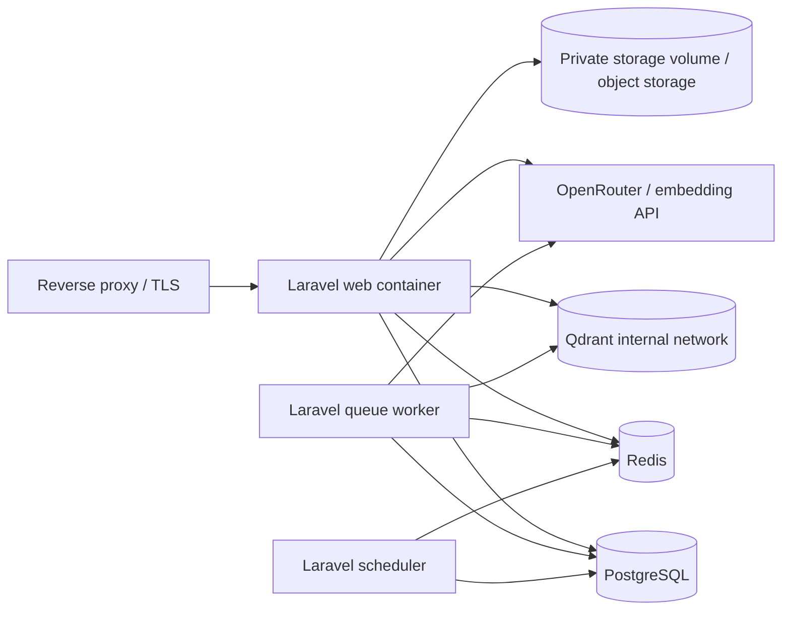

# Farmer IC RAG: technical execution blueprint

Dokumen ini adalah blueprint implementasi teknis RAG yang disesuaikan dengan repository Farmer IC saat ini: Laravel 13, PHP 8.5, Inertia/Vue 3, Docker, OpenRouter, percakapan AI yang menggunakan SSE, dan dokumen knowledge yang sudah team-scoped.

Rencana ini sengaja memakai RAG hanya untuk jalur knowledge dan panduan. Data aplikasi, STT, vision, dan image generation tetap memiliki pipeline khusus.

## 1. Target implementasi

Target MVP:

```text
User input
  → understanding + route
  → data service / knowledge retrieval / LLM / vision / infographic
  → evidence-aware generation
  → structured validation
  → citation + trace + feedback
```

Target kualitas:

- query dengan gaya bahasa berbeda menemukan evidence yang sama relevannya;
- data aplikasi tidak dikarang oleh LLM;
- knowledge tanpa evidence menghasilkan abstention;
- setiap klaim knowledge dapat ditelusuri ke source chunk;
- filter `team_id` mencegah cross-tenant retrieval;
- response lama tetap dapat dirender selama masa migrasi;
- setiap failure dapat dikategorikan sebagai routing, retrieval, generation, STT, vision, image, atau UI;
- model, prompt, embedding, chunking, dan retrieval policy dapat di-version dan di-rollback.

RAG bukan target untuk semua pertanyaan. Jalur data tetap deterministic, dan percakapan ringan tidak perlu selalu melakukan retrieval.

> **Demo scope:** Pada fase demo saat ini, security hardening, multi-tenant production isolation, backup production, dan compliance bukan blocker pengerjaan. Fokus utama adalah kualitas route, retrieval, grounded response, latency, dan evaluasi. Security detail tetap menjadi gate sebelum memakai data real atau membuka service ke production.

> **Implementation status:** P0 sudah berjalan dengan `InMemoryKnowledgeRetriever`. P1 sekarang menambahkan `EmbeddingGateway` OpenRouter, `QdrantClient`, `QdrantKnowledgeIndexer`, `VectorKnowledgeRetriever`, feature flag `AI_RAG_VECTOR_ENABLED`, serta command benchmark yang membandingkan retrieval in-memory dan vector pada prompt bahasa Indonesia. In-memory tetap menjadi default dan fallback ketika Qdrant/embedding belum tersedia; Qdrant adalah index yang dapat dibangun ulang dari source knowledge.

### P1 commands

```sh
# Jalankan Qdrant lokal bersama aplikasi (lihat DEPLOYMENT.md)
docker compose --env-file .env.docker -f compose.yaml -f compose.rag.yaml up --build

# Setelah database memiliki team dan API key embedding tersedia:
php artisan ai:knowledge:index-vector --team=<team-slug>
php artisan ai:knowledge:benchmark --team=<team-slug> --output=storage/app/private/ai-evals/retrieval.json
```

Benchmark mengukur `Hit@1` dan rata-rata latency untuk corpus evaluasi yang berisi paraphrase, pertanyaan pendek/panjang, typo ringan, pertanyaan gejala, finance guardrail, dan pertanyaan di luar domain. Test suite memakai fake gateway/store untuk memverifikasi bentuk request dan alur vector tanpa memerlukan API key; benchmark live memerlukan Qdrant dan provider embedding yang aktif.

`AI_RAG_VECTOR_MIN_SCORE` dipisahkan dari threshold in-memory. Nilai awal demo `0.30` dipilih setelah benchmark live untuk menolak evidence vector yang terlalu lemah dari prompt di luar domain; nilai ini harus dievaluasi lagi ketika corpus bertambah.

Vector retrieval memakai hybrid reranker (`0.85` semantic + `0.15` lexical) dan prior `application-facts` yang hanya aktif pada sinyal finance yang kuat. Embedding query dicache selama 10 menit berdasarkan model, dimensi, dan teks query; cache ini menurunkan latency prompt berulang tanpa mengubah source knowledge.

## 2. Arsitektur full



### 2.1 Production Docker topology



Satu VPS cukup untuk MVP jika inference memakai provider API dan Qdrant/PostgreSQL diberi volume persistent. Qdrant tidak dibuka ke internet; hanya Laravel yang mengaksesnya pada network internal Docker.

## 3. Efek terhadap repository saat ini

### 3.1 Komponen yang dipertahankan

Komponen berikut tetap menjadi fondasi:

- `app/AI/Services/AiChatService.php`: orchestrator percakapan dan SSE;
- `app/AI/Services/KnowledgeService.php`: diubah dari snapshot penuh menjadi source/index coordinator;
- `app/AI/Services/PromptAssembler.php`: diubah agar menerima evidence terpilih;
- `app/AI/Services/OpenRouterGateway.php`: gateway provider;
- `app/AI/Services/ModelRouter.php`: kandidat model dan fallback;
- `app/Models/AiKnowledgeDocument.php`: source of truth dokumen knowledge;
- `app/Models/AiConversation.php`, `AiMessage.php`, `AiUsageEvent.php`: conversation dan usage audit;
- `resources/js/composables/useAiChat.ts`: SSE dan response lifecycle;
- `resources/js/services/aiChatProtocol.ts`: parser transport;
- `resources/js/services/aiResponseValidator.ts`: validator client-side tambahan;
- `resources/js/services/aiIntentRouter.ts`: temporary optimistic router untuk UX, dengan server sebagai authority.

### 3.2 Komponen yang tidak boleh menjadi source of truth

- `resources/js/data/aiKnowledge.ts` hanya boleh dipakai untuk fallback demo, bukan knowledge production;
- `resources/js/services/aiKnowledgeService.ts` hanya boleh menjadi compatibility path selama migrasi;
- `ai_conversations.knowledge_snapshot` tidak boleh menjadi retrieval store baru;
- asset image generik tidak boleh menjadi fallback diam-diam untuk permintaan komoditas tertentu;
- client-side route tidak boleh menjadi satu-satunya authorization atau data boundary.

## 4. Direktori target

Struktur target yang mengikuti konvensi Laravel saat ini:

```text
app/
├── AI/
│   ├── Contracts/
│   │   ├── EmbeddingGateway.php
│   │   ├── KnowledgeIndexer.php
│   │   ├── Retriever.php
│   │   ├── ResponseVerifier.php
│   │   └── TraceRecorder.php
│   ├── Data/
│   │   ├── AiRouteDecision.php
│   │   ├── Evidence.php
│   │   ├── GroundedResponse.php
│   │   ├── RetrievalQuery.php
│   │   └── VisualSpec.php
│   ├── Exceptions/
│   │   ├── RetrievalUnavailableException.php
│   │   └── InvalidAiResponseException.php
│   ├── Jobs/
│   │   ├── IndexKnowledgeDocument.php
│   │   ├── ReindexKnowledgeCollection.php
│   │   └── EvaluateAiDataset.php
│   ├── Services/
│   │   ├── AiIntentRouter.php
│   │   ├── AiResponseVerifier.php
│   │   ├── AiTraceService.php
│   │   ├── KnowledgeChunker.php
│   │   ├── KnowledgeIndexerService.php
│   │   ├── KnowledgeRetriever.php
│   │   ├── PromptAssembler.php
│   │   ├── QdrantClient.php
│   │   ├── RetrievalPolicy.php
│   │   └── VisualSpecBuilder.php
│   └── Support/
│       ├── RrfFusion.php
│       ├── TextNormalizer.php
│       └── TokenBudget.php
├── Console/Commands/AI/
│   ├── CheckKnowledgeIndex.php
│   ├── EvaluateAi.php
│   ├── IndexKnowledge.php
│   └── ReindexKnowledge.php
└── Models/
    └── AiKnowledgeChunk.php

config/
└── ai.php                         # rag, embedding, qdrant, trace settings

database/migrations/
├── *_create_ai_knowledge_chunks_table.php
└── *_add_ai_version_fields.php

resources/ai/
├── knowledge/
│   ├── app-facts.md
│   ├── assistant-policy.md
│   └── agronomy/                  # curated published sources
└── evals/
    ├── golden-v1.jsonl
    └── rubrics-v1.yaml

resources/js/
├── services/
│   ├── aiChatProtocol.ts          # transport only
│   ├── aiResponseValidator.ts      # client safety check
│   └── aiTelemetry.ts              # client trace correlation
└── types/
    └── aiChat.ts                   # versioned response metadata

docker/
├── qdrant/
│   └── healthcheck.sh
└── worker/
    └── entrypoint.sh

compose.rag.yaml                   # local RAG profile
compose.production.yaml             # production services
docs/
└── ai-rag-runbook.md               # operator procedures
```

## 5. Data model

### 5.1 Knowledge document

`ai_knowledge_documents` sudah memiliki dasar yang tepat: `team_id`, `status`, `source`, `content_hash`, `version`, `published_at`, dan reviewer.

Tambahkan metadata yang diperlukan jika belum ada:

```php
Schema::table('ai_knowledge_documents', function (Blueprint $table): void {
    $table->string('locale', 16)->default('id-ID');
    $table->string('domain', 64)->nullable();
    $table->string('index_status', 32)->default('pending');
    $table->string('index_version', 64)->nullable();
    $table->timestamp('indexed_at')->nullable();
    $table->text('index_error')->nullable();
});
```

Dokumen `draft` dan `archived` tidak boleh digunakan pada production retrieval.

### 5.2 Knowledge chunk

```php
Schema::create('ai_knowledge_chunks', function (Blueprint $table): void {
    $table->id();
    $table->foreignId('ai_knowledge_document_id')
        ->constrained('ai_knowledge_documents')
        ->cascadeOnDelete();
    $table->foreignId('team_id')->constrained()->cascadeOnDelete();
    $table->unsignedInteger('chunk_index');
    $table->longText('content');
    $table->string('content_hash', 64);
    $table->string('chunking_version', 32);
    $table->string('embedding_model', 128);
    $table->string('qdrant_point_id', 128)->nullable();
    $table->unsignedInteger('token_count')->nullable();
    $table->json('metadata')->nullable();
    $table->string('status', 32)->default('pending');
    $table->timestamp('indexed_at')->nullable();
    $table->timestamps();

    $table->unique([
        'ai_knowledge_document_id',
        'chunk_index',
        'content_hash',
    ], 'ai_knowledge_chunks_identity');
    $table->index(['team_id', 'status']);
    $table->index(['ai_knowledge_document_id', 'chunk_index']);
});
```

PostgreSQL menyimpan canonical chunk. Qdrant menyimpan vector dan payload index. Jika Qdrant hilang, chunk tetap tersedia untuk rebuild.

### 5.3 Retrieval metadata

Setiap Qdrant point harus memiliki payload minimal:

```json
{
  "team_id": 12,
  "document_id": 91,
  "chunk_id": 342,
  "status": "published",
  "version": 3,
  "domain": "agronomy",
  "topic": "kedelai",
  "locale": "id-ID",
  "source": "Panduan budidaya kedelai",
  "content_hash": "sha256:...",
  "index_version": "embed-v1-chunk-v1"
}
```

Filter `team_id`, `status`, `locale`, dan `index_version` dilakukan saat query, bukan setelah hasil masuk ke prompt.

## 6. Indexing algorithm

### 6.1 Publish flow

```php
public function publish(Request $request, Team $currentTeam, AiKnowledgeDocument $document): JsonResponse
{
    $this->authorize('publish', $document);

    $document->forceFill([
        'status' => AiKnowledgeDocument::STATUS_PUBLISHED,
        'published_at' => now(),
        'index_status' => 'pending',
        'index_version' => app(RagConfig::class)->indexVersion(),
    ])->save();

    IndexKnowledgeDocument::dispatch($document->id)
        ->onQueue('ai-index');

    return response()->json([
        'status' => 'published',
        'index_status' => 'pending',
    ]);
}
```

Publish harus cepat dan tidak menunggu embedding provider. User melihat bahwa dokumen sudah published tetapi indexing masih berjalan.

### 6.2 Chunking

Chunker v1 tidak memakai pemotongan karakter buta. Prioritas boundary:

1. Markdown heading;
2. paragraph;
3. list item yang masih satu topik;
4. sentence boundary;
5. token budget.

Konfigurasi awal:

```php
'chunking' => [
    'version' => 'chunk-v1',
    'target_tokens' => 450,
    'max_tokens' => 650,
    'overlap_tokens' => 60,
],
```

Chunk tidak boleh memotong angka, dosis, periode, atau tabel penting dari heading/context-nya. Simpan `title`, `heading_path`, `source`, dan `domain` di metadata.

### 6.3 Index job

```php
final class IndexKnowledgeDocument implements ShouldQueue
{
    public function __construct(public readonly int $documentId) {}

    public function handle(
        KnowledgeIndexerService $indexer,
        AiKnowledgeDocument $documentRepository,
    ): void {
        $document = $documentRepository->newQuery()->findOrFail($this->documentId);

        if ($document->status !== AiKnowledgeDocument::STATUS_PUBLISHED) {
            return;
        }

        $indexer->index($document);
    }
}
```

`KnowledgeIndexerService` harus:

1. mengambil dokumen berdasarkan id;
2. memastikan status published;
3. menghitung `content_hash`;
4. membuat chunk idempotent;
5. membuat embedding batch;
6. upsert Qdrant dengan payload filter;
7. menyimpan point id dan `indexed_at`;
8. menandai dokumen `indexed`;
9. merekam latency, token, provider, dan error;
10. menghapus point lama hanya setelah versi baru berhasil.

Jika embedding atau Qdrant gagal, status menjadi `failed` dengan error yang dapat di-retry. Jangan menghapus index versi lama sebelum versi baru siap.

## 7. Retrieval algorithm

### 7.1 Route-aware retrieval

RAG hanya dipanggil jika route memutuskan `knowledge` atau route lain yang membutuhkan evidence. Router server menjadi authority; router frontend hanya membantu optimistic UI.

```php
$decision = $router->decide(
    text: $userText,
    history: $conversationState,
    attachments: $attachments,
);

if ($decision->needsClarification()) {
    return $this->clarification($decision);
}

return match ($decision->intent()) {
    AiIntent::DATA => $this->dataService->answer($decision),
    AiIntent::KNOWLEDGE => $this->knowledgePath->answer($decision),
    AiIntent::VISION => $this->visionPath->answer($decision),
    AiIntent::INFOGRAPHIC => $this->infographicPath->answer($decision),
    AiIntent::OUT_OF_SCOPE => $this->outOfScope($decision),
    default => $this->generalLlmPath->answer($decision),
};
```

### 7.2 Query construction

Retrieval query terdiri dari:

```text
raw_user_text
+ resolved conversation references
+ detected commodity/topic
+ detected phase or period
+ locale
+ team_id filter
+ published index version
```

Raw input tetap disimpan untuk audit. Query normalized/rewrite disimpan terpisah agar kesalahan rewrite dapat dilacak.

### 7.3 Hybrid retrieval

MVP retrieval:

1. sparse/lexical search untuk istilah persis;
2. dense vector search untuk paraphrase;
3. Reciprocal Rank Fusion (RRF) untuk menggabungkan ranking;
4. metadata filtering berdasarkan team/status/domain/locale;
5. optional reranking untuk top 8 kandidat;
6. threshold dan evidence diversity check;
7. top 3–5 chunk masuk ke prompt.

Pseudo-code:

```php
$lexical = $this->qdrant->sparseSearch($query, limit: 12, filter: $filter);
$dense = $this->qdrant->denseSearch($embedding, limit: 12, filter: $filter);
$fused = RrfFusion::merge($lexical, $dense);
$candidates = array_slice($fused, 0, 8);
$ranked = $this->reranker->rank($query, $candidates);
$evidence = EvidenceSelector::select(
    candidates: $ranked,
    maxItems: 4,
    minScore: config('ai.rag.min_evidence_score'),
);
```

Jika `evidence` kosong atau score di bawah threshold, jangan mengirim prompt generatif yang terlihat seolah-olah memiliki sumber. Kembalikan abstention atau pertanyaan klarifikasi.

### 7.4 Adaptive retrieval gate

Tidak semua turn membutuhkan retrieval. Gate v1 memakai kombinasi:

- intent/domain;
- presence of factual claim request;
- topic match;
- conversation context;
- retrieval cost budget;
- confidence router.

Contoh:

```php
if ($decision->isCasualGreeting() || $decision->isSimpleNavigation()) {
    return $generalLlmPath->answerWithoutRetrieval($decision);
}

if ($decision->isAgronomyGuide() || $decision->asksForApplicationFact()) {
    return $knowledgePath->answer($decision);
}
```

Jangan mengklaim bahwa gate ini sudah terkalibrasi sebelum diuji terhadap golden dataset.

## 8. Grounded generation

### 8.1 Prompt contract

Prompt builder menerima evidence, bukan knowledge snapshot penuh:

```php
$prompt = $promptAssembler->buildGrounded([
    'policy' => $policy,
    'question' => $decision->rawText(),
    'conversation' => $decision->relevantHistory(),
    'evidence' => $evidence,
    'output_schema' => GroundedResponse::schema(),
]);
```

Instruksi penting:

```text
Gunakan hanya evidence yang diberikan untuk klaim faktual Farmer IC.
Jika evidence tidak cukup, set should_abstain=true.
Jangan mengubah data, dosis, tanggal, status, atau nama sumber.
Setiap klaim factual harus memiliki evidence_ids.
Bedakan observasi gambar, fakta aplikasi, dan saran umum.
Jangan mengaku melakukan aksi atau membaca data live yang tidak diberikan.
```

### 8.2 Structured output

```php
final readonly class GroundedResponse
{
    /** @param list<Citation> $citations */
    public function __construct(
        public string $answer,
        public array $citations,
        public array $claims,
        public bool $shouldAbstain,
        public ?string $followUpQuestion,
        public string $schemaVersion = 'grounded-v1',
    ) {}
}
```

Jika provider tidak mendukung strict JSON schema, gunakan JSON extraction yang dibatasi, lalu validasi server-side. Jangan memperlakukan output text bebas sebagai object valid tanpa pemeriksaan.

### 8.3 Claim verification

Validator v1 memeriksa:

- response tidak kosong;
- schema valid;
- citation menunjuk chunk yang benar-benar di-retrieve;
- setiap claim punya evidence id;
- tidak ada evidence dari team lain;
- tidak ada prompt/system leakage;
- tidak lebih dari satu image utama;
- abstention konsisten dengan evidence threshold.

LLM-as-judge boleh dipakai sebagai metrik evaluasi, tetapi bukan satu-satunya security boundary. Authorization dan tenant filtering harus deterministic.

## 9. Data service path

Pertanyaan seperti kondisi kebun, transaksi, aktivitas, atau financial statement tidak boleh diselesaikan dengan similarity search.

```text
route data
→ parse entity/period/filter
→ query application database/service
→ return typed DTO
→ optional LLM wording
→ validate values unchanged
```

LLM hanya boleh merangkum DTO yang diberikan. Untuk angka, gunakan renderer atau formatter deterministic.

## 10. STT path

RAG tidak memperbaiki transcription. STT adapter perlu mengembalikan:

```php
final readonly class TranscriptResult
{
    public function __construct(
        public string $text,
        public ?float $confidence,
        public string $language,
        public array $alternatives,
        public string $provider,
        public int $latencyMs,
    ) {}
}
```

Jika confidence entity utama rendah:

```text
"Saya menangkap komoditasnya sebagai kedelai. Benar?"
```

Simpan raw transcript dan final corrected text dengan korelasi trace. Jangan langsung memasukkan transcript yang belum dikonfirmasi ke retrieval spesifik komoditas.

## 11. Vision and infographic path

### 11.1 Vision

Vision response dipisah menjadi:

```text
observation: yang terlihat pada gambar
evidence: sumber knowledge yang relevan
advice: saran umum yang diberi uncertainty
```

Gambar tidak menjadi bukti diagnosis definitif. LLM harus menyatakan keterbatasan jika gejala tidak cukup jelas.

### 11.2 Infographic

```php
final readonly class VisualSpec
{
    /** @param list<VisualStep> $steps */
    public function __construct(
        public string $title,
        public string $topic,
        public array $steps,
        public array $parameters,
        public array $evidenceIds,
        public string $imagePrompt,
    ) {}
}
```

Visual spec dibuat dari evidence yang lolos retrieval. Image model hanya membuat ilustrasi. Judul, angka, dosis, phase label, dan action step penting dirender sebagai UI/SVG text agar tidak bergantung pada kemampuan image model menulis teks.

Jika image generation gagal:

- tampilkan grounded text guide;
- gunakan asset lokal hanya jika topic dan caption cocok;
- jangan memakai asset generik tanpa menjelaskan bahwa itu ilustrasi umum;
- simpan failure trace dan provider error.

## 12. Server intent router

Frontend saat ini memiliki `resources/js/services/aiIntentRouter.ts`. Pada production, server harus memiliki authority yang sama atau mengembalikan keputusan server ke client.

Kontrak:

```php
final readonly class AiRouteDecision
{
    public function __construct(
        public string $intent,
        public string $domain,
        public string $period,
        public float $confidence,
        public float $ambiguityMargin,
        public bool $needsClarification,
        public string $routerVersion,
        public array $candidates,
    ) {}
}
```

Router v1 tidak harus memakai model terpisah. Implementasi awal dapat menggabungkan:

1. explicit high-confidence signals;
2. attachment modality;
3. conversation state;
4. semantic candidate scoring;
5. fallback clarification.

Rule harus menjadi high-precision guardrail, bukan daftar keyword yang mengklaim memahami semua bahasa user.

## 13. Trace and observability

### 13.1 Trace schema

Simpan metadata berikut pada `AiMessage.metadata`, `AiUsageEvent.metadata`, atau platform trace eksternal:

```json
{
  "trace_id": "tr_...",
  "conversation_id": 18,
  "team_id": 12,
  "router_version": "router-v2",
  "route": "knowledge",
  "route_candidates": [
    {"intent": "knowledge", "score": 0.82},
    {"intent": "llm", "score": 0.11}
  ],
  "query_rewrite": "panduan pemupukan jagung fase vegetatif",
  "retrieved_chunk_ids": [342, 351],
  "retrieval_scores": [0.84, 0.78],
  "index_version": "embed-v1-chunk-v1",
  "prompt_version": "grounded-v1",
  "model": "provider/model-id",
  "input_tokens": 800,
  "output_tokens": 260,
  "latency_ms": {
    "route": 42,
    "embedding": 180,
    "retrieval": 35,
    "generation": 1200,
    "validation": 8,
    "total": 1465
  },
  "abstained": false,
  "validation": {"ok": true, "issues": []}
}
```

Jangan menyimpan API key, authorization header, raw attachment, password, atau private content yang tidak diperlukan pada trace eksternal. Terapkan redaction dan retention policy.

### 13.2 Failure taxonomy

Gunakan kategori yang dapat ditindaklanjuti:

```text
router_low_confidence
router_wrong_route
query_rewrite_error
embedding_error
retrieval_empty
retrieval_irrelevant
tenant_filter_error
stale_index
generation_unsupported_claim
schema_invalid
citation_missing
stt_low_confidence
vision_uncertain
image_generation_failed
provider_timeout
renderer_error
```

Feedback `thumbs down` harus mengarah ke `trace_id`, bukan hanya disimpan sebagai angka agregat.

## 14. Configuration

Tambahkan konfigurasi server-side di `config/ai.php`:

```php
'rag' => [
    'enabled' => (bool) env('AI_RAG_ENABLED', false),
    'retrieval_enabled' => (bool) env('AI_RAG_RETRIEVAL_ENABLED', false),
    'qdrant_url' => env('QDRANT_URL', 'http://qdrant:6333'),
    'qdrant_collection' => env('QDRANT_COLLECTION', 'farmer_ic_knowledge'),
    'qdrant_api_key' => env('QDRANT_API_KEY'),
    'index_version' => env('AI_RAG_INDEX_VERSION', 'embed-v1-chunk-v1'),
    'chunking_version' => env('AI_RAG_CHUNKING_VERSION', 'chunk-v1'),
    'embedding_model' => env('AI_RAG_EMBEDDING_MODEL', 'text-embedding-3-small'),
    'top_k' => (int) env('AI_RAG_TOP_K', 8),
    'max_evidence' => (int) env('AI_RAG_MAX_EVIDENCE', 4),
    'min_evidence_score' => (float) env('AI_RAG_MIN_EVIDENCE_SCORE', 0.68),
    'shadow_mode' => (bool) env('AI_RAG_SHADOW_MODE', true),
    'schema_version' => env('AI_RAG_SCHEMA_VERSION', 'grounded-v1'),
],
```

Threshold `0.68` hanyalah placeholder konfigurasi. Threshold production harus ditentukan dari golden dataset, bukan diambil sebagai angka universal.

Environment contoh:

```dotenv
AI_RAG_ENABLED=false
AI_RAG_RETRIEVAL_ENABLED=false
AI_RAG_SHADOW_MODE=true
QDRANT_URL=http://qdrant:6333
QDRANT_COLLECTION=farmer_ic_knowledge
QDRANT_API_KEY=
AI_RAG_INDEX_VERSION=embed-v1-chunk-v1
AI_RAG_CHUNKING_VERSION=chunk-v1
AI_RAG_EMBEDDING_MODEL=text-embedding-3-small
AI_RAG_TOP_K=8
AI_RAG_MAX_EVIDENCE=4
```

Feature flag default harus aman. Implementasi baru pertama kali berjalan dalam shadow mode dan tidak mengubah jawaban user.

## 15. Docker implementation

### 15.1 Qdrant service

Pin image ke versi yang sudah diuji, jangan memakai `latest` pada production.

```yaml
services:
  qdrant:
    image: ${QDRANT_IMAGE:-qdrant/qdrant:<tested-version>}
    restart: unless-stopped
    expose:
      - "6333"
    volumes:
      - qdrant_storage:/qdrant/storage
    healthcheck:
      test: ["CMD-SHELL", "curl --fail --silent http://localhost:6333/healthz"]
      interval: 30s
      timeout: 5s
      retries: 3
```

Jangan menambahkan `ports: 6333:6333` pada production kecuali ada alasan operasional dan firewall yang sesuai.

### 15.2 Worker service

Gunakan image aplikasi yang sama agar dependency dan migration context konsisten:

```yaml
  worker:
    image: ${APP_IMAGE:-farmer-ic}:${APP_TAG:-latest}
    command: php artisan queue:work redis --queue=ai-index,default --sleep=2 --tries=3 --timeout=180
    env_file:
      - .env.production
    depends_on:
      redis:
        condition: service_healthy
      postgres:
        condition: service_healthy
      qdrant:
        condition: service_healthy
    restart: unless-stopped
```

Worker harus memiliki memory limit, log rotation, dan alert ketika restart berulang.

### 15.3 PostgreSQL dan Redis

Untuk VPS satu node, gunakan volume persistent dan backup terjadwal. Jangan menyimpan credential di git. Redis dipakai untuk queue/cache/rate limit, bukan sebagai source of truth.

## 16. One-day execution plan

Satu hari hanya untuk vertical slice dan pembuktian arsitektur.

### Jam 1: contracts and fixtures

- tambah DTO `Evidence`, `RetrievalQuery`, `GroundedResponse`;
- pilih satu domain, misalnya panduan kedelai;
- siapkan 10–20 dokumen curated;
- buat 30 golden prompts;
- definisikan expected evidence dan abstention.

### Jam 2: schema and indexer

- migration `ai_knowledge_chunks`;
- chunker by heading/paragraph;
- content hash dan idempotency;
- Qdrant collection lokal;
- index job satu dokumen.

### Jam 3: retriever

- embedding adapter;
- Qdrant query dengan `team_id` filter;
- top-k retrieval;
- score threshold;
- empty evidence result.

### Jam 4: grounded LLM path

- evidence-aware prompt;
- schema response;
- citation;
- abstention;
- SSE metadata compatibility.

### Jam 5: trace and validation

- trace id;
- retrieval metadata;
- provider/model/latency;
- validator;
- feedback correlation.

### Jam 6–8: regression and comparison

- baseline vs RAG;
- paraphrase, typo, short/long, voice-like input;
- no-evidence tests;
- tenant isolation;
- reindex idempotency;
- provider timeout;
- output schema failure.

Tidak boleh menyimpulkan RAG berhasil hanya karena satu query kedelai terlihat bagus.

## 17. Testing strategy

### Unit tests

- `KnowledgeChunkerTest`;
- `RrfFusionTest`;
- `RetrievalPolicyTest`;
- `AiIntentRouterTest`;
- `GroundedResponseTest`;
- `AiResponseVerifierTest`;
- `VisualSpecBuilderTest`;
- `TranscriptConfidenceTest`.

### Feature tests

- publish document membuat indexing job;
- draft tidak dapat diretrieve;
- team A tidak dapat mengambil chunk team B;
- index gagal menghasilkan status failed dan retryable error;
- response citation menunjuk chunk yang benar;
- abstention saat evidence kosong;
- conversation lama tetap dapat dibuka;
- SSE tetap compatible dengan frontend saat metadata ditambahkan.

### Integration tests

Dengan Qdrant dan PostgreSQL test container:

- create collection;
- index fixture;
- query hybrid;
- filter team;
- delete/rebuild index;
- compare retrieval results.

### Evaluation tests

Dataset JSONL:

```json
{
  "id": "soybean-001",
  "input": "cara nanam kedelai dari awal gimana",
  "expected_route": "knowledge",
  "expected_topics": ["kedelai", "penanaman"],
  "expected_abstention": false,
  "required_source_ids": ["soybean-guide-v1"],
  "rubric": ["relevan", "grounded", "tidak mengarang dosis"]
}
```

Simpan baseline per `model_version`, `prompt_version`, `index_version`, dan `retrieval_policy_version`.

## 18. Rollout and rollback

### Rollout

1. deploy schema dan service tanpa mengaktifkan RAG;
2. index dokumen dalam shadow mode;
3. bandingkan route dan evidence tanpa mengubah response;
4. aktifkan RAG hanya untuk satu domain;
5. canary satu team;
6. monitor metrics dan feedback;
7. perluas route jika tidak ada regression.

### Rollback

RAG dapat dimatikan dengan environment flag:

```dotenv
AI_RAG_ENABLED=false
AI_RAG_RETRIEVAL_ENABLED=false
```

Rollback tidak boleh menghapus PostgreSQL chunk atau Qdrant volume. Simpan data untuk investigasi dan rebuild. Rollback code/model/index dilakukan berdasarkan version, bukan edit manual.

## 19. Definition of done

### Vertical slice selesai jika

- satu domain knowledge dapat di-index;
- retrieval mengembalikan evidence dengan filter team;
- jawaban memiliki citation;
- evidence kosong menghasilkan abstention;
- query paraphrase masuk ke evidence yang sama;
- response schema divalidasi;
- trace menyimpan route, evidence, model, prompt, latency, dan validation;
- RAG dapat dimatikan melalui feature flag;
- test baseline dan RAG dapat dibandingkan.

### Production candidate selesai jika

- PostgreSQL migration dan backup/restore teruji;
- Redis worker dan scheduler memiliki health check;
- Qdrant rebuild dari source berhasil;
- tenant isolation test lulus;
- golden dataset tidak mengalami regression;
- p95 latency memiliki budget;
- cost per route diketahui;
- prompt/model/embedding/index version dapat di-rollback;
- runbook operator tersedia;
- canary dan alert berjalan.

## 20. Hal yang sengaja tidak dilakukan pada MVP

- tidak memakai multi-agent untuk routing sederhana;
- tidak memasukkan seluruh conversation ke retrieval;
- tidak memakai vector search untuk angka/status yang tersedia di database;
- tidak membuat image model menjadi sumber fakta;
- tidak mengaktifkan RAG untuk semua query secara paksa;
- tidak mengganti SQLite production tanpa backup dan cutover plan;
- tidak menambah framework Python hanya karena populer;
- tidak menganggap similarity score sebagai confidence manusia;
- tidak menyatakan sistem production-ready setelah satu demo berhasil.

## 20.1 Prioritas demo saat ini

Karena data masih mock/demo, urutan kerja yang diprioritaskan adalah:

1. **Route benar**: data, knowledge, LLM, vision, infographic, atau klarifikasi;
2. **Retrieval relevan**: paraphrase, typo, pertanyaan pendek/panjang, dan konteks percakapan;
3. **Jawaban grounded**: evidence, citation, abstention, dan tidak mengarang angka;
4. **Presentation benar**: data tetap teks/data card, panduan tetap readable, infografis hanya saat diminta;
5. **Trace dan eval**: dapat mengetahui apakah failure berasal dari router, retrieval, model, atau renderer;
6. **Latency dan cost**: ukur sebelum menambah reranker, agent, atau model lain.

Security hardening tidak menjadi bagian dari acceptance gate demo. Untuk demo, cukup gunakan data fixture, credential lokal, Qdrant lokal, dan feature flag. Security gate diaktifkan kembali pada fase transisi ke data real dan production VPS.

## 21. Sumber rujukan

- [Conversational RAG survey](https://link.springer.com/article/10.1007/s44163-026-02373-y)
- [Multimodal RAG survey, ACL 2025](https://aclanthology.org/2025.findings-acl.861/)
- [Adaptive Retrieval-Augmented Generation](https://arxiv.org/abs/2407.21712)
- [OpenAI Knowledge Retrieval starter kit](https://github.com/openai/openai-knowledge-retrieval)
- [Haystack evaluation pipeline](https://github.com/deepset-ai/haystack/blob/main/e2e/pipelines/test_evaluation_pipeline.py)
- [Qdrant hybrid queries](https://qdrant.tech/documentation/search/hybrid-queries/)
- [Qdrant filtering](https://qdrant.tech/documentation/search-patterns/vector-search-filtering/)
- [Rasa FallbackClassifier](https://github.com/RasaHQ/rasa/blob/3.6.x/docs/docs/components.mdx)
- [Langfuse observability](https://github.com/langfuse/langfuse-docs/blob/main/content/docs/observability/overview.mdx)
- [OpenTelemetry GenAI observability](https://opentelemetry.io/blog/2026/genai-observability/)
- [DeepEval RAG Triad](https://github.com/confident-ai/deepeval/blob/main/docs/content/guides/guides-rag-triad.mdx)

## 22. Logging, monitoring, dan resource budget

### 22.1 Apakah log RAG masuk Laravel log atau log terpisah

Jawabannya: gunakan beberapa lapisan dengan tujuan berbeda. Jangan menyalin semua prompt dan response ke satu file log.

#### Laravel operational log

`storage/logs/laravel.log` atau daily channel dipakai untuk:

- Qdrant tidak dapat dihubungi;
- embedding provider timeout;
- indexing job gagal;
- migration/configuration error;
- response schema invalid;
- worker restart atau retry exhausted;
- security dan tenant-filter failure.

Operational log menyimpan id dan metadata minimal, bukan isi private prompt atau attachment.

Contoh:

```php
Log::warning('RAG retrieval failed', [
    'trace_id' => $traceId,
    'team_id' => $teamId,
    'route' => $route,
    'error_type' => $exception::class,
    'index_version' => $indexVersion,
]);
```

Untuk production, gunakan `daily` dengan retention terbatas, misalnya 14–30 hari, log rotation, dan export ke host logging jika diperlukan.

#### Structured AI audit

Log file tidak cocok untuk dashboard kualitas. Gunakan `AiUsageEvent` yang sudah ada untuk provider, model, token, latency, request id, dan metadata. Tambahkan event retrieval atau metadata terstruktur untuk:

```text
trace_id
route
router_version
retrieved_chunk_ids
retrieval_scores
index_version
prompt_version
abstained
validation_status
failure_category
```

Jika volume mulai besar, buat tabel khusus `ai_retrieval_events` atau archive `AiUsageEvent` berdasarkan bulan. Jangan memasukkan raw attachment atau secret.

#### External trace

Langfuse atau Phoenix digunakan setelah trace internal stabil. Platform ini berguna untuk replay, prompt version, dataset, evaluasi, dan perbandingan model. Ia bukan pengganti Laravel log atau database audit.

Rekomendasi tahap:

```text
MVP: Laravel log + AiUsageEvent metadata
Staging: tambah structured retrieval event
Production: tambah Langfuse atau Phoenix dengan sampling/redaction
```

Frontend `useAiTelemetry.ts` saat ini memakai browser storage untuk demo. Itu tidak cukup sebagai production monitoring karena data hanya berada di browser user dan tidak dapat digunakan untuk cross-user analysis.

### 22.2 Retention dan privacy

Default production:

- operational log: 14–30 hari;
- raw prompt/response eksternal: disabled atau heavily redacted;
- retrieval metadata: 30–90 hari sesuai kebutuhan audit;
- aggregate latency/cost/error: lebih lama;
- golden dataset: versioned dan tidak dihapus bersama log runtime;
- attachment: mengikuti policy storage terpisah, bukan telemetry.

Trace harus memakai `trace_id`, `conversation_id`, `team_id`, dan hash bila cukup. Isi user dapat disimpan hanya jika ada kebutuhan debugging yang jelas dan retention yang disetujui.

### 22.3 Apakah RAG berat untuk disk

Untuk corpus kecil, RAG tidak berat. Beban terbesar berasal dari vector index, attachment, dan retention trace.

Per vector 1536 dimensi dengan float32, data mentahnya sekitar 6 KB sebelum payload dan index graph. Setelah metadata, HNSW/index overhead, dan storage, gunakan estimasi awal 10–20 KB per chunk. Angka aktual bergantung pada dimensi embedding, quantization, payload, dan konfigurasi Qdrant.

Perkiraan kasar:

| Jumlah chunk | Perkiraan vector/index | Catatan |
| ---: | ---: | --- |
| 10.000 | 100–250 MB | cocok untuk MVP |
| 100.000 | 1–2,5 GB | perlu volume dan backup terencana |
| 1.000.000 | 10–25 GB | perlu capacity planning dan tuning serius |

PostgreSQL juga menyimpan teks chunk, metadata, dan index relational. Jangan lupa disk untuk uploaded image, database WAL, backup, Docker layer, dan log.

Qdrant adalah index yang dapat dibangun ulang. Backup utama tetap berasal dari PostgreSQL dan source knowledge. Untuk production, backup Qdrant mempercepat recovery tetapi tidak boleh menjadi satu-satunya backup.

### 22.4 Apakah RAG berat untuk RAM dan CPU

RAG tidak membutuhkan GPU jika embedding dan generation dilakukan oleh API provider. CPU dan RAM VPS dipakai untuk Laravel, PostgreSQL, Redis, Qdrant, worker, dan reverse proxy.

Perencanaan awal satu VPS:

| Resource | MVP kecil | Production nyaman |
| --- | --- | --- |
| RAM | 4 GB dengan limits ketat | 8 GB atau lebih |
| CPU | 2 vCPU | 4 vCPU atau lebih |
| Disk | 40–80 GB SSD | 100 GB+ sesuai attachment/corpus |
| GPU | tidak diperlukan jika provider eksternal | tetap tidak wajib untuk API-based inference |

Ini bukan angka jaminan. Uji dengan corpus dan concurrency nyata. Qdrant dapat memakai RAM untuk cache/index, PostgreSQL membutuhkan memory untuk query dan connection, dan Laravel worker dapat memakai hingga memory limit PHP per process.

Indexing dilakukan asynchronous agar embedding batch atau reindex tidak memblokir request chat. Batasi concurrency worker agar tidak menghabiskan CPU/RAM VPS.

### 22.5 Apakah RAG boros token AI

RAG menambah satu query embedding dan evidence context, tetapi dapat mengurangi token karena tidak lagi mengirim seluruh knowledge snapshot pada setiap generation.

Kontrol token:

- embedding hanya saat dokumen baru/berubah, bukan setiap indexing loop;
- satu embedding untuk query final, bukan semua intermediate rewrite;
- `top_k` awal 8 lalu maksimal 3–4 evidence masuk prompt;
- chunk target 350–500 token;
- batasi `max_evidence` dan `max_output_tokens`;
- cache query embedding untuk query identik yang berulang dalam waktu pendek;
- jangan melakukan LLM-as-judge pada setiap request production;
- jalankan eval berat secara async pada sample atau golden dataset.

Rumus cost konseptual:

```text
total cost
= embedding tokens × embedding price
+ (prompt input tokens + output tokens) × model price
+ STT audio cost
+ image generation cost
+ optional evaluator cost
```

RAG cenderung lebih hemat ketika knowledge corpus lebih besar daripada context yang diperlukan. RAG dapat menjadi lebih mahal jika top-k terlalu besar, chunk terlalu panjang, query rewrite berulang, atau reranker dan evaluator dipanggil tanpa budget.

### 22.6 Budget latency

Target awal per route:

```text
data local:       tidak memanggil LLM bila tidak perlu
retrieval:        Qdrant internal network, puluhan hingga ratusan ms
knowledge LLM:    retrieval + provider generation
STT:              upload + transcription provider
infographic:      retrieval + image provider, paling lambat
```

Trace harus memisahkan route, embedding, retrieval, rerank, provider first token, generation, dan validation. Jangan memperbaiki latency dengan mematikan validator atau menghapus evidence tanpa evaluasi.

### 22.7 Safe default sebelum production

```dotenv
AI_RAG_ENABLED=false
AI_RAG_RETRIEVAL_ENABLED=false
AI_RAG_SHADOW_MODE=true
AI_RAG_MAX_EVIDENCE=4
AI_RAG_TOP_K=8
AI_RAG_MAX_OUTPUT_TOKENS=700
LOG_CHANNEL=daily
LOG_DAILY_DAYS=14
```

Urutan aktivasi:

1. indexing tanpa mengubah jawaban;
2. shadow retrieval pada sample terbatas;
3. periksa retrieval score dan tenant filter;
4. aktifkan satu domain pada satu team canary;
5. ukur kualitas, latency, cost, dan feedback;
6. perluas hanya jika baseline tidak mengalami regression.

Kesimpulan operasional: RAG tidak perlu membuat log dan resource membengkak jika raw content tidak disalin sembarangan, evidence dibatasi, indexing asynchronous, dan trace memakai retention/sampling. Untuk corpus MVP, 4 GB dapat dipakai sebagai lingkungan uji dengan limits; untuk production yang lebih stabil, rencanakan 8 GB atau pisahkan PostgreSQL/Qdrant dari web container.

## 23. Transisi data mock/demo ke data real

### 23.1 Kondisi saat ini

Repository masih memiliki sumber demo di frontend, termasuk:

- `resources/js/data/farmDemo.ts`;
- `resources/js/data/farmerFinance.ts`;
- `resources/js/data/activityLogs.ts`;
- `resources/js/data/kebun.ts`;
- `resources/js/services/aiDemoDataService.ts`;
- browser storage demo dengan key berprefix `demo_`;
- fallback visual dan knowledge client untuk stakeholder prototype.

Sumber tersebut aman untuk local demo jika dipisahkan dari credential dan data production. Sumber tersebut tidak boleh menjadi authority di production karena dapat menampilkan data fiktif sebagai kondisi user.

### 23.2 Mode environment

Gunakan mode eksplisit:

```dotenv
# local / staging demo
APP_ENV=local
DEMO_MODE=true
AI_RAG_ENABLED=true

# production
APP_ENV=production
DEMO_MODE=false
AI_RAG_ENABLED=true
```

Production harus memiliki guard server-side. Jika `DEMO_MODE=false`, request ke demo resolver harus:

- tidak dipanggil;
- tidak memiliki fallback mock diam-diam;
- menghasilkan error konfigurasi saat dipakai secara tidak sengaja;
- tercatat sebagai deployment/configuration defect.

Feature flag production tidak boleh hanya berupa boolean di frontend karena dapat diubah oleh user.

### 23.3 Kontrak source agar UI tidak perlu ditulis ulang

Buat interface service yang sama untuk demo dan real data:

```php
interface FarmDataSource
{
    public function gardenStatus(Team $team, FarmQuery $query): GardenStatusDto;

    public function recentActivities(Team $team, FarmQuery $query): ActivitySummaryDto;

    public function financeSummary(Team $team, FinanceQuery $query): FinanceSummaryDto;
}
```

Implementasi:

```text
DemoFarmDataSource       local/staging only
PostgresFarmDataSource   production
```

Keduanya mengembalikan DTO yang sama. Halaman Vue dan response renderer tidak perlu mengetahui apakah data berasal dari fixture atau PostgreSQL.

### 23.4 Jalur data real

Untuk data kebun, aktivitas, dan finansial:

```text
user question
→ server intent/entity parser
→ authorization team/user
→ typed PostgreSQL query/service
→ DTO dengan nilai asli
→ optional LLM summarization
→ validator menjaga angka/status tetap sama
→ response
```

Data transaksi tidak dimasukkan ke vector database sebagai pengganti SQL. Vector search buruk untuk exact totals, date ranges, balances, status, dan permission-sensitive records.

LLM hanya menerima DTO yang sudah difilter dan boleh merangkum. LLM tidak membuat query bebas terhadap database dan tidak menerima koneksi database langsung.

### 23.5 Knowledge real

Knowledge pertanian yang stabil atau diterbitkan masuk ke:

```text
ai_knowledge_documents (PostgreSQL source of truth)
→ published/reviewed
→ chunk + embedding job
→ Qdrant index
```

Data real yang berubah per transaksi tetap berada di PostgreSQL. Jika sebuah laporan perlu dijelaskan dengan knowledge, gabungkan secara terkontrol:

```text
SQL result: angka/status real
+ RAG evidence: aturan/panduan yang relevan
→ LLM explanation
```

Jangan menulis transaksi real ke knowledge corpus hanya karena user menanyakannya sekali.

### 23.6 Keamanan lokal dan production

#### Local

- gunakan SQLite/demo fixtures atau PostgreSQL lokal terpisah;
- gunakan Qdrant collection lokal yang berbeda;
- jangan pernah memakai `OPENROUTER_API_KEY` production;
- gunakan data tersanitasi;
- browser storage hanya berisi demo state;
- `.env` tidak boleh masuk git;
- test tenant isolation dengan fixture.

#### Staging

- database dan Qdrant terpisah dari production;
- gunakan subset data yang dianonimkan;
- API key dan collection berbeda;
- jalankan migration dan reindex penuh sebelum canary;
- jangan menyalin production trace mentah tanpa redaction.

#### Production

- `DEMO_MODE=false` server-side;
- tidak menjalankan demo seed atau mock resolver;
- PostgreSQL menjadi source of truth;
- Qdrant hanya accessible melalui internal Docker network;
- filter `team_id` pada SQL dan Qdrant;
- logs dan traces melalui redaction/retention;
- backup PostgreSQL dan Qdrant recovery procedure;
- deletion/archival dokumen menghapus atau menonaktifkan point index terkait;
- reset demo data tidak boleh muncul pada user production.

### 23.7 Rencana migrasi

1. Tetapkan DTO dan interface `FarmDataSource`.
2. Pindahkan query demo di belakang `DemoFarmDataSource`.
3. Buat `PostgresFarmDataSource` dengan authorization dan tests.
4. Jalankan kedua source pada staging dan bandingkan DTO.
5. Matikan demo resolver pada production melalui server feature flag.
6. Import data real dengan migration/ETL terpisah dan audit row count.
7. Index hanya published knowledge real ke Qdrant.
8. Jalankan golden prompts dengan data real yang dianonimkan.
9. Canary satu team.
10. Hapus demo fallback setelah production stabil dan rollback window selesai.

### 23.8 Kriteria aman

Transisi dianggap aman jika:

- tidak ada route production yang mengimpor `resources/js/data/*` sebagai source data;
- tidak ada response production dengan label `demo`, `seed prototipe`, atau fixture;
- semua data query memiliki team/user authorization;
- data real dan demo memakai database/Qdrant collection berbeda;
- vector index dapat dibangun ulang dari knowledge source;
- angka dan status dari SQL tidak berubah setelah LLM merangkum;
- fallback ketika PostgreSQL/Qdrant/provider gagal menyatakan error atau unavailable, bukan mengeluarkan mock.

